# Confluence Process Flow — TrinityX Installer

Generate a Mermaid flowchart describing the runtime behaviour of the Go installer for TrinityX HPC compute nodes, then publish its companion notes and source to the canonical Confluence page. The rendered diagram itself lives in a draw.io macro on the page, populated by the user via Mermaid import (one copy/paste per regeneration). This avoids paying for a Mermaid rendering app while keeping everything else automated.

The diagram must reflect what the code actually does, not what an installer "usually" does. Treat unverified assumptions as defects.

## Configuration (project-specific)

| Field | Value |
| --- | --- |
| Confluence site | `clustervision.atlassian.net` |
| Space key | `TRIX` |
| Page ID | `959741961` |
| Page title | `Code logic in combination with Luna` |
| Section markers | `<!-- BEGIN: installer-flow-autogen -->` … `<!-- END: installer-flow-autogen -->` |
| Local Mermaid source | `docs/diagrams/installer-flow.mmd` |
| Local companion notes | `docs/diagrams/installer-flow.md` |

The section markers exist so this skill can update one well-defined region of the page without disturbing manually-written content above or below it — including the draw.io macro that holds the rendered diagram.

## Goal

Four artifacts, three automated, one manual:

1. `docs/diagrams/installer-flow.mmd` — Mermaid source in the repo. **Source of truth.**
2. `docs/diagrams/installer-flow.md` — companion notes with file/line citations.
3. The auto-gen section on Confluence page `959741961` updated to match: companion notes prose + the Mermaid source in a code block + an inline reminder to re-import.
4. The draw.io macro on the same page — updated manually by the user, by copy/pasting the Mermaid code block from (3) into the macro's Mermaid importer.

The skill does (1)–(3) end-to-end. Step (4) is one operator action, ~20 seconds, and only required when the diagram actually changed.

## Before you start

1. Read the **Learnings & adaptations** section at the bottom of this file. Every preference there is binding for this run unless the user explicitly overrides it.
2. Verify you have Confluence API access to the target space, and that the
   canonical page exists. Step 5 (publishing the notes and Mermaid source) cannot
   run without it.

## Step 1 — Inventory the codebase

Run these in the repo root and read the results before generating anything:

```bash
# Subprocess invocations — the "Go tools used at various stages"
rg -n "exec\.Command|exec\.CommandContext" --type go

# JSON read/write sites — reveals the 3 JSON files and when they're updated
rg -n "json\.(Unmarshal|Marshal|NewDecoder|NewEncoder)|\.json" --type go

# Struct definitions with json tags — these are the JSON schemas
rg -n 'json:"' --type go

# Luna integration — HTTP calls, base URLs, package names
rg -n -i "luna" --type go

# Discovery vs predefined branch
rg -n -i "discover|disklayout|partition" --type go

# CLI flags — what the operator passes in
rg -n "flag\.|cobra|pflag|viper" --type go

# Entry point
rg -n "func main" --type go
```

For each subprocess call site, capture: **which binary** (parted, sgdisk, mkfs.*, mount, rsync, tar, grub-install, grub-mkconfig, efibootmgr, lsblk, blkid, …), **which stage** it belongs to, and **what guards it** (e.g. `if cfg.UEFI` around `grub-install` — that's a decision node).

For each JSON site, capture: **filename**, **direction** (read / write / both), **trigger** (always vs conditional), and the **struct** it (de)serializes into. There should be three. If you find more or fewer, surface that in the companion `.md` — do not silently collapse to three.

## Step 2 — Reconstruct the flow

Walk from `main()` outward and build the call graph before touching Mermaid. The flow has a known skeleton — your job is to fill in real names, real tools, real conditions:

1. **Luna phase** — Luna assembles the node configuration and triggers the installer (PXE / iPXE / kexec — verify which). Identify exactly which fields Luna provides that the installer **requires** vs **optional** vs **only-required-on-path-B**. Answer this explicitly: "what input is required where, when is something not required" is the question the user cares about most.
2. **Path decision** — discovery vs predefined disklayout. Find the flag, env var, or config field that selects between them. Name it in the diagram.
3. **Path A — Discovery.** What does discovery enumerate? Where does the result get written? Confirm whether `disklayout.json` is **written** on this path and cite the line.
4. **Path B — Predefined.** Confirm `disklayout.json` is consumed as-is. Note any validation step (e.g. "fail if declared device not present").
5. **Partition + format + mount.** List every external tool with its stage.
6. **OS install.** Identify the image source and the streaming/extraction tool.
7. **Bootloader.** Find the condition that gates GRUB installation. Common shapes: `if !uefi`, `if _, err := os.Stat("/sys/firmware/efi"); err != nil`, or a config field. Whatever it is, that's the decision node label.
8. **Finalize + reboot.** Unmounts, fstab writes, signalling back to Luna.

## Step 3 — Emit Mermaid

Use this skeleton, replacing every placeholder with values verified in Steps 1–2. Do not ship placeholders. If something can't be verified, mark it `TODO(verify)` in the diagram and call it out in the companion `.md` rather than guessing.

```mermaid
flowchart TD
    Start([Operator provisions node via Luna]) --> LunaCfg

    subgraph LunaPhase[Luna phase]
        LunaCfg[Luna assembles node config]
        LunaCfg --> NodeCfg[("&lt;json-file-1&gt;.json<br/>required: …<br/>optional: …")]
        NodeCfg --> Trigger["Luna triggers installer<br/>via &lt;PXE|iPXE|kexec&gt;"]
    end

    Trigger --> Boot[/Go installer boots/]
    Boot --> PathDecision{"Disk layout source?<br/>(flag: --&lt;name&gt;)"}

    subgraph PathA[Path A — Discovery]
        DiscRun["Run discovery<br/>tool: &lt;binary&gt;"]
        DiscRun --> DiscEnum["Enumerate disks<br/>tool: lsblk / blkid"]
        DiscEnum --> DiscWrite[("&lt;json-file-2&gt;.json<br/>WRITTEN by installer")]
    end

    subgraph PathB[Path B — Predefined]
        PreLoad["Load disklayout from Luna"]
        PreLoad --> PreRead[("&lt;json-file-2&gt;.json<br/>read as-is")]
        PreRead --> PreValidate["Validate vs present hardware"]
    end

    PathDecision -->|discovery selected| DiscRun
    PathDecision -->|disklayout provided| PreLoad

    DiscWrite --> Partition
    PreValidate --> Partition

    subgraph DiskPhase[Disk phase]
        Partition["Partition<br/>tool: parted / sgdisk"]
        Partition --> Format["mkfs<br/>tool: mkfs.ext4 / mkfs.xfs / mkswap"]
        Format --> Mount["Mount targets under /mnt"]
    end

    Mount --> OSInstall

    subgraph OSPhase[OS phase]
        OSInstall["Stream OS image<br/>tool: &lt;rsync|tar|other&gt;"]
        OSInstall --> PostCfg[("&lt;json-file-3&gt;.json<br/>applied: fstab, network, packages")]
    end

    PostCfg --> BootDecision{"Bootloader needed?<br/>(condition: &lt;cite the check&gt;)"}

    subgraph BootPhase[Bootloader phase]
        BootDecision -->|yes| GRUB["Install GRUB<br/>tool: grub-install + grub-mkconfig"]
        BootDecision -->|no| SkipBoot["Skip bootloader install"]
        GRUB --> EFI["efibootmgr (if UEFI)"]
    end

    EFI --> Finalize
    SkipBoot --> Finalize
    Finalize["Unmount, sync, signal Luna"] --> Reboot([Reboot into provisioned node])

    classDef json fill:#fef3c7,stroke:#92400e,stroke-width:1.5px;
    classDef decision fill:#dbeafe,stroke:#1e40af,stroke-width:1.5px;
    class NodeCfg,DiscWrite,PreRead,PostCfg json;
    class PathDecision,BootDecision decision;
```



### Mermaid conventions for draw.io import

- `flowchart TD` (top-down). draw.io's Mermaid importer handles this cleanest.
- One **subgraph per phase** — Luna / Disk / OS / Bootloader. Readers scan phase-by-phase.
- **JSON files are cylinder nodes** `[(name)]`, styled yellow via `classDef json`. Always label which fields are required vs optional and whether the file is read or written.
- **Decision nodes are diamonds** `{Question?}`, styled blue. Label both outgoing edges with the condition, not just one side.
- **Tool annotations** live inside the node label on a second line prefixed `tool:` — keeps the tool visible without needing edge labels.
- Use `<br/>` for line breaks inside labels. `\n` doesn't survive draw.io import reliably.
- Stick to Mermaid features that draw.io's importer supports — `flowchart`, `subgraph`, basic shapes, `classDef`. Avoid post-v10 syntax until verified.

## Step 4 — Write the companion `.md`

```
# TrinityX installer flow — companion notes

## JSON inputs
### <json-file-1>.json
- Source: <Luna>
- Direction: read
- Required fields: <list with file:line citations>
- Optional fields: <list>
- When updated: <never / on path X / always>

### <json-file-2>.json
…

### <json-file-3>.json
…

## Decision points
### Disk layout source (path A vs path B)
- Selector: <flag/env/field> at <file:line>
- Effect on disklayout.json: written on path A, read-only on path B

### Bootloader install
- Condition: <code snippet> at <file:line>
- Tools when yes: grub-install, grub-mkconfig, efibootmgr
- Tools when no: —

## External tools by stage
| Stage | Tool | Call site |
| --- | --- | --- |
| Partition | parted | pkg/disk/partition.go:42 |
| … | … | … |

## Open questions / TODO(verify)
- <anything you couldn't confirm from the code>
```

Every claim must cite `file:line`. If a claim has no citation, it doesn't belong in the companion.

## Step 5 — Publish to Confluence

### 5a. Fetch the current page

Use the Atlassian MCP to fetch page `959741961` from space `TRIX`. Capture both the page body (in storage format) and the current version number — Confluence requires the version on update.

### 5b. Locate the auto-gen section

**Use heading-text boundaries, not HTML comments.** Confluence's storage-format processor strips `<!-- … -->` comments on save, so the original BEGIN/END comment markers are unreliable for round-trip. Identify the section by its magic `<h2>`:

- **Begin marker:** the literal `<h2>...>Installer flow &mdash; source &amp; companion notes (auto-generated)</h2>` (Confluence may inject a `local-id` attribute; match by text content).
- **End marker:** end-of-body. The autogen section is always the final block.

Anything **before** the h2 is preserved untouched — that's where the user's draw.io macro (rendered diagram) lives.

- **h2 found**: replace everything from the h2 to end-of-body with the freshly generated section. Re-extract any draw.io macro from above the h2 and keep its position.
- **h2 absent**: this is the first publish to this page. **Stop and ask the user** where to insert (top of body, bottom, or after a specific heading). Default suggestion: bottom. On first publish there is no draw.io macro yet — the user adds it manually after the autogen section appears (see Step 5e closing).

### 5c. Build the new section

The auto-gen section deliberately does **not** include the rendered diagram — that lives in a separate draw.io macro the user maintains, positioned **above** the autogen `<h2>` so future regenerations preserve it untouched. The section provides three things: a reminder to re-import, the Mermaid source as a copy-pasteable code block, and the companion notes.

Confluence storage format (no HTML-comment markers — they don't survive):

```
<h2>Installer flow &mdash; source &amp; companion notes (auto-generated)</h2>
<p><em>Generated from the installer source on YYYY-MM-DD. Source of truth: <code>docs/diagrams/installer-flow.mmd</code> in the repo. Do not edit this section by hand — edits will be overwritten on the next regeneration. The draw.io macro above this heading is outside the autogen zone and survives every publish; re-import the Mermaid block below into it when the diagram changes.</em></p>
<ac:structured-macro ac:name="info">
  <ac:rich-text-body>
    <p><strong>Diagram updated? Re-import the Mermaid source below into the draw.io macro above.</strong></p>
    <p>How: copy the Mermaid block below → edit the draw.io diagram above → <em>Arrange → Insert → Advanced → Mermaid</em> → paste → Insert. Takes ~20 seconds.</p>
  </ac:rich-text-body>
</ac:structured-macro>
<h3>Mermaid source</h3>
<ac:structured-macro ac:name="code">
  <ac:parameter ac:name="language">text</ac:parameter>
  <ac:parameter ac:name="title">installer-flow.mmd</ac:parameter>
  <ac:plain-text-body><![CDATA[
<paste the full contents of installer-flow.mmd here, no triple-backtick fences>
  ]]></ac:plain-text-body>
</ac:structured-macro>
<h3>Companion notes</h3>
<!-- body of installer-flow.md converted to Confluence storage format -->
```

The full PUT body is the assembly: `[existing draw.io macro from above the h2] + [autogen section above]`. Anything else outside the autogen zone (e.g. user-added prose at the top of the page) is also preserved verbatim — only the autogen `<h2>` and everything after it gets replaced.

Notes on the storage format:

- The `code` macro is built into Confluence (no app required). `language=text` avoids syntax highlighting that might mangle the Mermaid; `mermaid` as a language hint also works on some sites but renders identically as far as draw.io's importer cares — it copies pure text.
- The `info` macro is also built in. If for some reason it doesn't render on this site, fall back to a plain `<blockquote>` with `<strong>` — the reminder doesn't need styling, just visibility.
- Convert the companion `.md` to Confluence storage format faithfully: `##` → `<h3>`, tables → `<table>`/`<tr>`/`<td>`, inline code → `<code>`, bold → `<strong>`. Keep code citations (`file:line`) as inline `<code>` so they stand out.

### 5d. Show the user the diff before pushing

Before calling the MCP update, print to chat:

- Size of old section (lines) vs new section (lines)
- A short summary of structural changes (e.g. "added decision node for UEFI detection; renamed json-file-2 → disklayout.json; removed dead Path B validation step")
- Whether the **Mermaid source itself** changed compared to the version currently in the auto-gen section — this is what tells the user whether a re-import into the draw.io macro is actually needed. If the diagram is byte-identical to last run, say so explicitly: "Mermaid unchanged — no draw.io re-import needed."
- The page URL: `https://clustervision.atlassian.net/wiki/spaces/TRIX/pages/959741961`

Ask explicit confirmation: **"Push this to Confluence? (y/n)"** Don't proceed on silence or a maybe.

### 5e. Update the page

Call the Atlassian MCP (or `curl` against the Confluence REST API) to update page `959741961`. Payload shape: `{version: {number: N+1}, type: "page", title: <unchanged>, body: {storage: {value: <new body>, representation: "storage"}}}`.

**Handle HTTP 409 (version conflict).** If the user is editing the page concurrently — common when they're adding a draw.io macro or fixing a typo — your fetched version is stale. Refetch the page, re-extract the draw.io macro from the now-current body (its `local-id` / `macro-id` may differ), rebuild the body, and retry with the bumped version.

After the update, confirm in chat:

- New page version number and link
- **If the Mermaid changed**: one-line reminder — "Open the page, edit the draw.io macro above the autogen heading, re-import the Mermaid block from the code macro below it. ~20 seconds."
- **If the Mermaid didn't change**: say so. No action needed.
- **On first publish** (no draw.io macro on the page yet): include a one-time setup recipe — "After this publish, scroll up to the top of the page, insert a draw.io macro above the autogen heading, then import the Mermaid block."

## Step 6 — Update this skill's Learnings section

Before ending the turn, if any of the following happened, append an entry to the Learnings section below using `str_replace`:

- The user asked for a structural change to the diagram (new subgraph, removed phase, different branch shape).
- The user asked for a style/convention change (shape choice, colour, labelling pattern).
- You discovered a non-obvious code pattern future runs should know about (e.g. "tool dispatch goes through `internal/runner.Run`, not direct `exec.Command`").
- You found a JSON file that wasn't in the previous run's inventory, or one disappeared.
- The user moved the auto-gen section, changed its heading, or asked for different content inside it.
- A Confluence storage-format quirk on this site needed working around (e.g. info macro not rendering).

Format each entry:

```
- YYYY-MM-DD — <one-line summary>. Apply by: <concrete instruction for the next run>. Origin: <"user request" | "code discovery" | "publish step">.
```

Keep entries terse and actionable. If a new learning contradicts an older one, replace the older one rather than stacking — this section is a live preference set, not a changelog.

---

## Learnings & adaptations

<!-- Updated at the end of each run, per Step 6. Entries are binding for subsequent runs. -->

- 2026-05-23 — There are **7 JSON files**, not 3: `install-context.json`, `storage.json`, `discover-config.json`, `osimage-filter.json` (Luna-supplied), plus `storage-result.json`, `storage-resolved.json`, `boot-context.json` (installer-produced). `storage.json` is dual-direction (read by lpart-storage-prepare; written by lpart-discover). Apply by: do not collapse to 3; document all 7 in the companion. Origin: code discovery.
- 2026-05-23 — The "discovery vs predefined" 2-way path-decision framing is wrong; actual routing is `install_mode ∈ {auto, mem, force-init}` with `auto` sub-branching on which Luna JSON field is populated (`storage.json` populated → use as-is; else `discover-config.json` populated → lpart-discover; else memory-root default). Apply by: render mode as a 3-way diamond with auto's sub-decision nested. Origin: code discovery.
- 2026-05-23 — `osimage_sync ∈ {Sync, Full, Local}` is a second top-level enum that routes to a different binary entirely (`lpart-osimage-install` for Sync/Full, `lpart-storage-check` for Local — no extract). Apply by: render osimage_sync as its own diamond after lpart-storage-prepare. Origin: code discovery.
- 2026-05-23 — All subprocess calls go through `executor.Runner.Run(ctx, executor.CommandSpec{...})`. The single sanctioned `exec.CommandContext` site is `internal/executor/executor.go:186`; direct `exec.Command` outside that lives only in the TUI shell handoff and engine child-orchestration. Apply by: cite executor.go:186 as the chokepoint when describing tool invocations; do not grep for `exec.Command` and treat each result as a stage. Origin: code discovery.
- 2026-05-23 — `runtime/examples/{prescript,partscript,postscript}.sh` was the canonical Luna orchestration view but the directory was deleted in commit `079610f`. Read the last-alive version via `git show fbdf6f3:runtime/examples/partscript.sh`. Apply by: don't trust `ls runtime/` to exist on a fresh clone; pull from git history. Origin: code discovery.
- 2026-05-23 — User's Atlassian account email is `alex.ninaber@clustervision.com`, NOT `alex.ninaber@pandorax.nl` (which is the git/chat email). Confluence Basic auth requires the email tied to the token's owning account. Apply by: always confirm Atlassian login email separately when the chat-context email differs from the customer tenant. Origin: publish step.
- 2026-05-23 — First publish to page 959741961 chose "replace stub" (delete the existing empty `<p local-id=.../>` rather than appending after it). Apply by: on the next regeneration, the marker pair will be present so this question doesn't recur; if the page is ever reset to a stub, default to replacing it. Origin: user request.
- 2026-05-23 — Confluence Cloud markdown→storage-format converter is inline Python (`/tmp/md2storage.py`, not committed). The companion has nested unordered lists (`-` indented 2 spaces), code spans, bold, blockquotes, one big table, and `---` hr — every construct verified rendering correctly. No `pandoc` available on this controller. Apply by: keep the inline converter as a build step; do not commit a Python script to the repo (the project bans Python). Origin: publish step.
- 2026-05-23 — `mermaid-cloud` macro name not probed yet — the published page uses a plain `code` macro (no Mermaid renderer dependency) plus a user-maintained draw.io macro for the rendered diagram. Apply by: stick with the code-macro + draw.io split; do not add a `mermaid-cloud` / `mermaid` macro unless the user explicitly asks to render server-side. Origin: user-set workflow.
- 2026-05-23 — **Confluence strips HTML comments** during storage-format save. The `<!-- BEGIN/END: installer-flow-autogen -->` markers in the v2 publish vanished on round-trip; v4 fetch showed `has_markers=false`. Apply by: identify the autogen section by the magic `<h2>` text ("Installer flow — source & companion notes (auto-generated)"), replacing from that h2 to end-of-body. Do not rely on HTML comments as data. Origin: publish step (round-trip surprise on v4 fetch).
- 2026-05-23 — **draw.io macro placement convention**: the user-maintained draw.io macro (holding the rendered diagram) sits ABOVE the autogen `<h2>`, outside the regenerated zone. Page order is: [draw.io macro] → [autogen h2] → [info reminder] → [Mermaid source code macro] → [companion notes]. Apply by: on every regeneration, extract the existing draw.io macro from the current body (regex on `<ac:structured-macro ac:name="drawio".*?</ac:structured-macro>`), keep it verbatim, prepend to the new autogen section before PUTting. Origin: user request after v4 layout collision.
- 2026-05-23 — **HTTP 409 on PUT means the user is editing concurrently.** Refetch the page (new version + new body, possibly with reshuffled `local-id`/`macro-id` attributes on the draw.io macro), re-extract the macro from the FRESH body, rebuild the payload with `version+1`, retry. Hit this on the v5→v6 transition while the user was importing the Mermaid into the macro. Apply by: bake the refetch+retry into the publish step rather than failing on first 409. Origin: publish step.
- 2026-05-23 — Codebase cleanup landed (commit pending): removed `INSTALLER_PLAN.md`, `tui-design.plan`, `scripts/fake-installer.sh`, `scripts/run-on-node.sh`, `tests/integration/` (all 5 files), `testdata/README.md`. Removed `make test-node` target. Rewrote `docs/README.md` to point at the new diagram artifacts. Rewrote `BOOKKEEPING.md` (875→757 lines): dropped retired §B.1 and §D.9, compressed §C migration phases into an archived `<details>` block, dropped resolved §J, updated §H/§I/§K to drop references to deleted scripts and integration tests. §G decision log kept in full per user choice. Apply by: do not re-introduce `tests/integration/`, `INSTALLER_PLAN.md`, or per-scenario prescript directories; regression is operator-driven via `regression.md`. Origin: user request.
