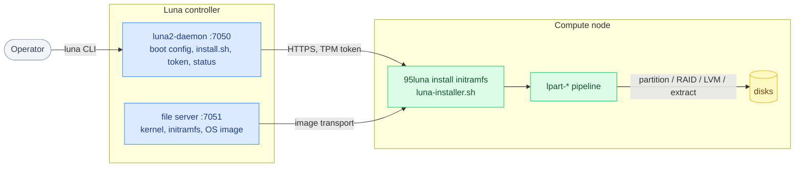
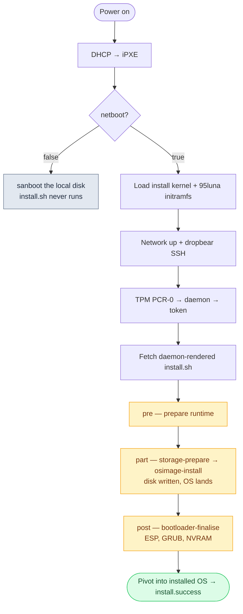

# Luna Node Installer — Architecture Overview

*What this page is for: the shape of the system, the case for its design, and an honest read on where it stands — the page you show a new senior hire and a sceptical lead.*

## Executive summary

The **Luna Node Installer** takes a TrinityX node from power-on to a running operating system. It is the node-side install path — a dracut initramfs module plus a set of Go binaries — driven by data the **Luna daemon** renders per node. A node carries no state of its own: everything is fetched from the controller (the daemon REST API on `:7050`, the image file server on `:7051`).

It lives across two repositories:

1. **`clustervision/luna2-client`** — the node-side client. The dracut **`95luna`** module (`…/modules.d/95luna/`: `luna2-start.sh`, the shared `luna-installer.sh`, `module-setup.sh`) is the install initramfs; **`advanced-partitioner/`** is the Go localboot installer (the `lpart-*` binaries).
2. **`clustervision/luna2-daemon`** — the controller. It renders the per-node boot config and `install.sh`, packs the OS image, and holds the node/group attributes (`daemon/base/boot.py`, `daemon/routes/boot.py`, `daemon/templates/`).

The headline design idea: a node states a **desired state** in one field, `install_mode`, and the installer makes the node match it — install if blank, refresh if healthy, repair if broken, **never touch declared data**. Disks are chosen by **tags** rather than device paths, so one group definition fits a fleet of mixed hardware.

## System context

## Where we stand

Honest self-assessment against what the cloud-native and AI-factory world expects (the gaps are tracked on **10 — Gaps & Risks**):

| What the modern world expects | Where this installer stands |
|---|---|
| Declarative desired state | **Covered.** One `install_mode` per node or group. |
| Self-healing / reconcile | **Covered.** `auto` repairs a node back to a healthy state. |
| Converge to a golden image, repeatable | **Covered.** `sync` converges and is safe to repeat. |
| Choose hardware by labels, not device paths | **Covered.** Disks chosen by tags (`ssd`, `nvme`, `rotary`) and size. |
| Group-level config with per-node override | **Covered.** Group→node inheritance. |
| Stateless compute plus persistent data | **Covered.** `memboot` + persistent DATA sets. |
| Secure wipe for tenant turnover | **Covered.** The `sanitize` mode. |
| Continuous drift detection while a node runs | **Planned as observability** (Prometheus + alerting). Auto-reconcile on a timer is a deliberate non-goal for HPC/AI. See 10. |
| A declarative API / GitOps surface | **Not yet.** See 10. |
| Measured boot and remote attestation | **Not yet.** See 10. |

## The shape: power-on → install → first boot

The installer adds storage logic to the **existing Luna boot chain**. End to end (full detail on **03 — Data Flows**):

1. **Firmware → DHCP → iPXE** → the node chainloads iPXE, pointed at the daemon's HTTP boot endpoint.
2. **`GET /boot/search/mac/<mac>`** → the node hands back its MAC; the daemon identifies it and checks the `netboot` flag.
3. **Install or boot the disk?** `netboot=false` → the node `sanboot`s its own disk (steady state). `netboot=true` → the daemon serves the **install** boot script.
4. **Load kernel + install initramfs** from `:7051/files`; the kernel command line (`root=luna`, `luna.*`) is the daemon→node contract.
5. **Inside the ramdisk** (`95luna`/`luna2-start.sh`): bring up the network, start **dropbear** SSH for debugging, authenticate with a **TPM token**, then `curl` the daemon-rendered **`install.sh`**.
6. **`install.sh`** runs the node's `prescript` / `partscript` / `postscript` — on a model node each is a one-line shim that execs **`lpart-phase`**, which drives the `lpart-*` pipeline (storage → image → bootloader).
7. **Pivot** into the freshly-provisioned root; the node reports `install.success` and reboots onto its disk.

## System boundaries

**External** (what the node talks to):

| Boundary | Protocol | Authentication | Purpose |
|---|---|---|---|
| Node ↔ Luna daemon | HTTPS `:7050` | TPM-issued JWT (`scope: provision`, ~60 min) | boot config, `install.sh`, status, secrets |
| Node ↔ file server | HTTP(S) `:7051/files` | install token (`x-access-tokens`) | kernel, initramfs, OS image tarball |
| Firmware ↔ DHCP / iPXE | DHCP / TFTP / HTTP | none → token after | PXE chainload |
| Operator ↔ installer | SSH `:22` (dropbear) | controller `authorized_keys` | debug a node mid-install |
| Node ↔ TPM | local PCR-0 read | — | the measurement that mints the token |

**Internal** (the install initramfs + installer):

| Layer | Path | Responsibility |
|---|---|---|
| dracut module | `luna2-client/.../95luna/luna2-start.sh` + `luna-installer.sh` | the install initramfs: network, SSH, token, fetch + run `install.sh` |
| phase shim | `…/95luna/lpart-phase` | the one-line pre/part/post exec → `lpart-node-installer --phase 
` |
| orchestrator | `advanced-partitioner/cmd/lpart-node-installer` | runs the in-process pipeline + the live TUI |
| storage | `cmd/lpart-storage-prepare`, `lpart-storage-check` (`internal/{discover,diskresolve,raid,lvm,partition,fs}`) | discover/resolve disks, partition/RAID/LVM/mkfs, mount the sysroot, the data fence |
| image | `cmd/lpart-osimage-install` (`internal/osimage`) | download + extract the OS image, the preserve filter |
| bootloader | `cmd/lpart-bootloader-finalise` (`internal/bootloader/{rhel,debian,suse}.go`) | fstab, signed shim + GRUB into the ESP, UEFI NVRAM entry |

## Technology stack

| Layer | Technology | Version | Notes |
|---|---|---|---|
| Installer | Go | static, cgo-free | one codebase, cross-compiled **linux/amd64 + linux/arm64** |
| Init system | dracut `95luna` module | — | the shared install initramfs across redhat/opensuse/ubuntu |
| Side effects | the `internal/executor` package | — | single chokepoint: logging, timeouts, secret redaction, dry-run |
| Boot | UEFI only | — | vfat ESP at `/boot/efi`, `/boot` fs, root on LVM/RAID; ARM via SBBR |
| Bootloader adapters | `internal/bootloader/{rhel,debian}.go` implemented; `suse.go` stub | — | a family is one interface, not a fork of the engine |

## Highlights

A few genuinely notable properties of this installer (each anchored; see the linked pages):

- **Fully re-entrant by design.** The partitioner can be re-run any number of times within a boot and across reinstalls and always converges to the declared layout; every step checks "is this already done?" before acting (`internal/` re-entrancy tests). A retry, or a customer reformatting a whole cluster, lands in exactly the same correct state.
- **No kickstart, AutoYaST or Preseed at all.** Storage is built natively from one distro-agnostic JSON document (`internal/disklayout` grammar) into partitions, RAID, LVM and filesystems.
- **Reinstall repeatedly without ever wiping a data disk.** Wiping a DATA set requires saying `full` out loud; the data fence (`lpart-storage-prepare`) protects everything else.
- **One module, every distro.** redhat, openSUSE and Ubuntu install through the *same* dracut `95luna` module and the same `lpart-*` binaries.
- **It narrates itself.** The whole install streams to the controller over rsyslog (`/var/log/cluster-messages/<host>.messages`) — a banner with the hardware and plan, every stage, a dmesg snapshot, errors as `err` lines, tokens redacted — plus a live TUI on the console (`cmd/lpart-tui`).
- **Pin a discovered layout.** `selection: discover` + `save: true` writes the resolved layout back to the node as `manual`, so a fleet-wide template freezes per-node once it has resolved (ADR-0008).

## Deployment & packaging

Every `lpart-*` binary is a static build baked into the install initramfs by per-distro/arch packaging trees: **six trees** — `redhat`, `opensuse`, `ubuntu` × `x86`, `arm` — each with its own RPM/DEB recipe. **Honest status:** redhat/x86_64 is validated end-to-end on real hardware; openSUSE/Ubuntu and ARM are wired but not yet fully on-node-proven, and the SUSE bootloader adapter is a deliberate stub. Those are next targets, not hidden assumptions (see **07** and **10**).

> **Note on the daemon side.** The `install_mode` routing and the lpart install template (`templ_install_lpart.cfg`) currently live in the **deployed** daemon and are staged for upstream — not yet merged into `luna2-daemon:development`. The node-side client (the `95luna` module + `lpart-*`) is on the `advanced-partitioner` branch.

---
*Generated against `luna2-client@advanced-partitioner` on 10 Jun 2026. Next: 02 — Module Map.*
