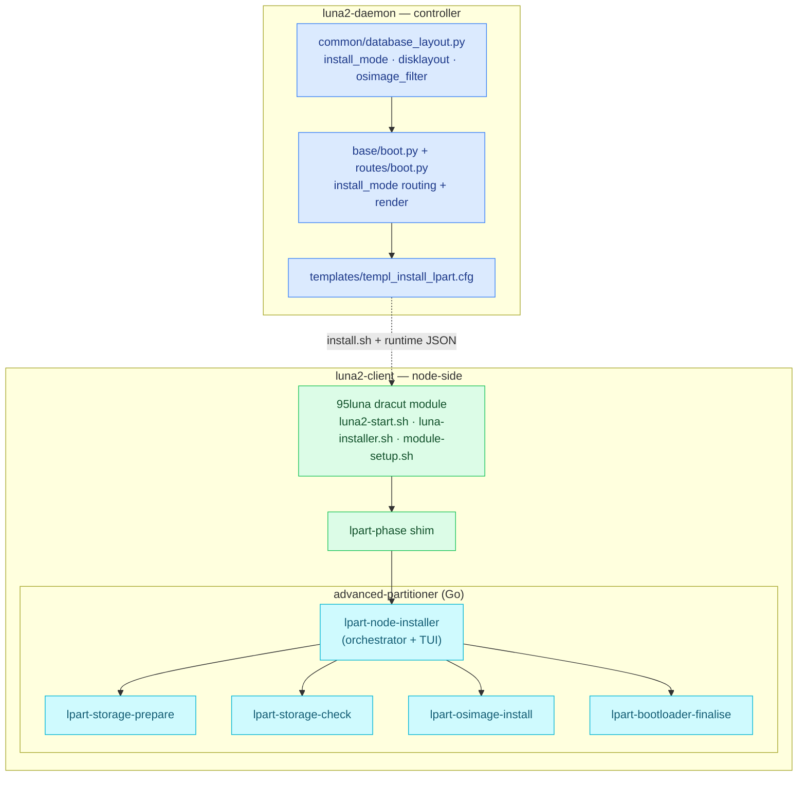

# Luna Node Installer — Module Map

Where the code lives. The installer spans two repositories: the **node-side client** (`clustervision/luna2-client`, branch `advanced-partitioner`) and the **controller** (`clustervision/luna2-daemon`).

## Node-side client — `luna2-client`

### The dracut `95luna` module — the install initramfs

Per-distro/arch trees under `{redhat,opensuse,ubuntu}/{x86,arm}/src/usr/lib/dracut/modules.d/95luna/`. The body is byte-identical across distros:

| File | Responsibility |
|---|---|
| `module-setup.sh` | dracut build hook — installs the toolset, keys, `luna.ini`, the `lpart-*` binaries, and bash so the shared body runs on every distro |
| `luna2-start.sh` | the thin per-distro entrypoint (dracut `initqueue/finished` hook) — console/log capture, sources the shared body |
| `luna-installer.sh` | the **shared installer body** (byte-identical across distros): network, dropbear SSH, the TPM token, fetch + run `install.sh`, the retry/park policy |
| `luna-parse-cmdline.sh` | dracut `cmdline` hook — sets `rootok=1` for `root=luna` |
| `lpart-phase` | the one-line pre/part/post shim → `exec lpart-node-installer --phase <phase>` |
| `sshd_config`, `bashrc`, `profile` | the install-shell environment |

### `advanced-partitioner/` — the Go localboot installer

| `cmd/` binary | Responsibility |
|---|---|
| `lpart-node-installer` | the orchestrator (`--phase pre/part/post`), drives the pipeline + the live TUI |
| `lpart-storage-prepare` | discover/resolve disks, partition/RAID/LVM/mkfs, mount the sysroot, the data fence |
| `lpart-storage-check` | health probe for an existing layout (`auto`/`sync`/`local`) |
| `lpart-osimage-install` | download + extract the OS image, the preserve filter |
| `lpart-bootloader-finalise` | fstab, signed shim + GRUB into the ESP, UEFI NVRAM entry |
| `lpart-emit`, `lpart-tui` | the decoupled install-dashboard renderer (ADR-0009) |

| `internal/` package | Responsibility |
|---|---|
| `model`, `config`, `lpartinputs`, `installcontext` | the disklayout grammar, config parse/validate, the runtime inputs the daemon writes |
| `discover`, `diskresolve`, `devices`, `disk` | hardware discovery + resolving a `match`/manual selection to real devices |
| `partition`, `raid`, `raidlevel`, `lvm`, `fs`, `fscheck`, `mount` | the storage execution primitives |
| `engine`, `pipeline`, `plan`, `cleanup` | the decision engine + the phased pipeline |
| `osimage` | image download + extract + the filter |
| `bootloader` | the family adapters (`rhel.go`, `debian.go`, `suse.go` stub), fstab, UEFI/NVRAM |
| `executor` | **the single side-effect chokepoint** — every external command (logging, timeouts, secret redaction, dry-run) |
| `luna`, `lunaclient` | reading the kernel cmdline / the daemon write-back client (the `save` flow) |
| `installerui`, `eventbus`, `cli`, `log` | the TUI, the event bus, flag parsing, logging |

## Controller — `luna2-daemon`

| File / area | Responsibility |
|---|---|
| `daemon/base/boot.py` | resolves `install_mode` and **chooses the install template** (`legacy` → `templ_install.cfg`, else → `templ_install_lpart.cfg`) |
| `daemon/routes/boot.py` | renders the per-node `install.sh` — incl. `LUNA_INSTALL_MODE` / `LUNA_DISKLAYOUT_B64` / `LUNA_OSIMAGE_FILTER_B64` |
| `daemon/common/database_layout.py` | the node/group columns: `install_mode`, `disklayout`, `osimage_filter` |
| `daemon/templates/templ_install_lpart.cfg` | the lpart pipeline template (`write_provisioning_inputs` + the pre/part/post shims) |
| `daemon/plugins/osimage/operations/image/{redhat,opensuse,ubuntu}.py` | OS-image pack (builds the install initramfs with dracut `--add luna`) |
| `daemon/base/{node,group}.py` | the group→node cascade for the three fields |

## Cross-repo contracts

| Producer | Consumer | Contract |
|---|---|---|
| daemon `routes/boot.py` | node `luna-installer.sh` | the kernel cmdline (`root=luna`, `luna.*`) |
| daemon `templ_install_lpart.cfg` | node `lpart-*` | `/tmp/install_files/runtime/{storage,osimage-filter,install-context}.json` |
| node `lpart-storage-prepare` (`save`) | daemon node `disklayout` | the pinned `manual` layout written back (ADR-0008) |

---
*Generated against `luna2-client@advanced-partitioner` on 10 Jun 2026. Next: 03 — Data Flows.*
