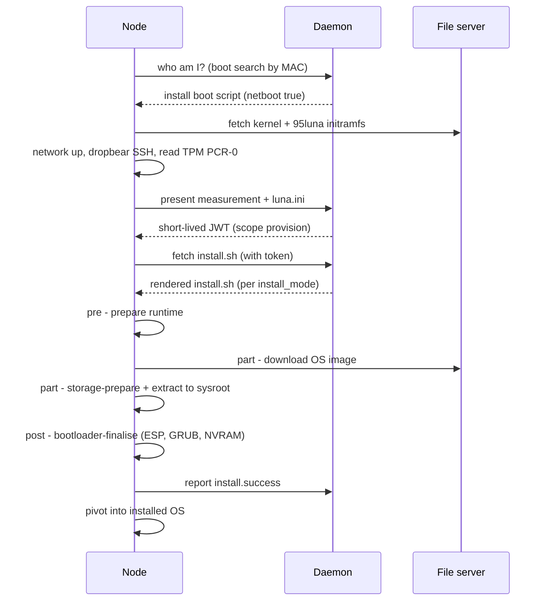

# Luna Node Installer — Data Flows

This is what actually happens at runtime, in order: power-on → the install ramdisk → the daemon-rendered `install.sh` → the node's pre/part/post scripts → the `lpart-*` workers. A node carries no state of its own; **everything is fetched from the controller** (the daemon API on `:7050`, the image file server on `:7051`). The whole design intent is that the daemon *produces* a per-node contract and the node *consumes* it.

## 1. From power-on to `install.sh` — the boot chain

1. **Firmware → DHCP → iPXE.** The NIC firmware DHCPs; the cluster DHCP server returns an address plus a `next-server`/boot file that chainloads **iPXE**, pointed at the daemon's HTTP boot endpoint.
2. **The boot menu (`GET /boot`).** iPXE runs `chain /boot/search/mac/<mac>`: the node hands its MAC back and asks *"who am I, and what should I boot?"*
3. **Install, or boot the disk? (`discover_mac`).** The daemon identifies the node by MAC, resolves its osimage kernel/initramfs, and checks the node/group **`netboot`** flag:
   - **`netboot = false`** → serves the **local-disk boot** script; the node `sanboot`s its own disk and `install.sh` **never runs**. This is the steady state of an installed node.
   - **`netboot = true`** → serves the **install** boot script; the node is marked `install.discovered`. (If the osimage is mid-repack the daemon withholds the boot, so the node waits rather than pulling a half-packed image.)
4. **Load the install kernel + initramfs** from `:7051/files`. The kernel command line is the **daemon→node contract** — every parameter the ramdisk needs (`root=luna`, `boot=ramdisk`, and the `luna.*` parameters: `url`, `node`, `hostname`, `mac`, `ip`, `gw`, `verifycert`, `loghost`, `service`). The full listing is on **06 — Configuration Reference**. `root=luna` is what makes the Luna ramdisk hook take over instead of mounting a real root, and `luna.service=1` short-circuits to a maintenance shell that installs nothing.

## 2. Inside the install ramdisk — *before* `install.sh`

The install initramfs is the **same packed image's** ramdisk with the `95luna` dracut module (`luna2-start.sh`) baked in. It carries the toolset (disk tools, `curl`/`aria2c`, `tpm2`, the `dropbear` SSH daemon), the controller's SSH host keys + `authorized_keys`, `luna.ini`, and the `lpart-*` binaries. In order:

1. **Network + a debug surface.** Set the hostname, **start `dropbear` (SSH on port 22)** and a login shell on `tty2` so an operator can SSH into a node that is installing or wedged, then bring the provisioning NIC up — matching `luna.mac` to an interface, DHCP or static `luna.ip`/`luna.gw`. (`luna.service=1` short-circuits to a plain shell and installs nothing.)
2. **Authenticate (TPM token).** The node reads its TPM **PCR-0** measurement and POSTs it with the `luna.ini` credentials to **`/tpm/<node>`**; the daemon validates it and returns a short-lived JWT (`scope: provision`, ~60 min) to `/lunatmp/token.dat`. This token gates everything that follows.
3. **Fetch the installer.** The hook `curl`s **`/boot/install/<node>`** (carrying the token), retrying until HTTP 200 — the body is `install.sh`, rendered fresh by the daemon.
4. **Run it, with a retry policy.** On success the ramdisk tears down (kills `dropbear`/dhclient, moves the install log into `/sysroot/var/log`) and **pivots into the freshly-provisioned root**. On failure it snapshots `dmesg`, forwards the log, and either **parks** in a maintenance shell (config error, exit 3) or shows an **interruptible 30-second retry countdown**.

## 3. The dynamic installer — `install.sh`, chosen by `install_mode`

`install.sh` is **not a fixed file**: the daemon renders it per request and **chooses the template from the node's `install_mode`**:

- `install_mode = legacy` → the **original bash installer** (`templ_install.cfg`: full `tar` unpack, the node's bash pre/part/post, no `lpart-*`).
- any other mode (`auto`/`sync`/`full`/`local`/`memboot`/`sanitize`; default `auto`) → the **v1.4 lpart installer** (`templ_install_lpart.cfg`).

Same packed image, same install ramdisk for both — *only the rendered `install.sh` differs*, picked from one field (`daemon/base/boot.py`). Moving a node between `legacy` and the model is a field change; nothing is rebuilt.

**The data the daemon writes into the template** — this is what the node consumes: the file URLs and token, the OS image name, the provision method/fallback, the per-interface network, the BMC config, the **base64-encoded pre/part/post field scripts**, and — for the lpart template — the node's **`install_mode`**, **`disklayout`** and **`osimage_filter`** (`daemon/routes/boot.py` renders `LUNA_INSTALL_MODE` / `LUNA_DISKLAYOUT_B64` / `LUNA_OSIMAGE_FILTER_B64`). The template's `write_provisioning_inputs` step base64-decodes those into `/tmp/install_files/runtime/storage.json` and `osimage-filter.json`, which the `lpart-*` binaries read.

## 4. When pre/part/post run

Each is the node's **field script** — the *same* `prescript` / `partscript` / `postscript` group→node attributes Luna has always had — fired by `install.sh` at a fixed point. On a model node each is a one-line shim that execs `lpart-phase`, so the right column is what the lpart pipeline does in that phase:

| Phase | Fires at | What `lpart-phase <phase>` runs |
|---|---|---|
| **pre** | before the runtime inputs are written, before BMC | make the runtime/sysroot dirs |
| **part** | after BMC, before the (no-op) legacy download | `storage-prepare` (discover/partition/RAID/LVM/mkfs/mount) → `osimage` (download + extract into the sysroot). **This is where the disk is written and the OS lands.** |
| **post** | after the OS is on disk *and* network + secrets are in place | `bootloader` finalise (fstab, signed shim + GRUB into the ESP, UEFI NVRAM entry) — *why* it is post: the installed system must already exist |

A non-zero exit from any field script aborts the install, and the ramdisk retries. On a `legacy` node the very same fields hold ordinary bash and the template runs them directly.

## 5. The full `install.sh` sequence

Top to bottom; **no reboot inside it** — it ends by reporting success and control returns to the ramdisk, which pivots into `/sysroot`. Each `install.<stage>` is a `POST /monitor/node/<node>` — the *"Luna installer: <stage>"* lines the controller streams. The ▶ rows are the plug points above:

| # | Step | What it does | Status |
|---|---|---|---|
| 1 | `lunainit` | create runtime + systemroot dirs | |
| 2 | `dynamic_ip_check` | if DHCP, POST the leased IP back to the node record | |
| 3 | `node_scripts` | download any `--scripts` plugin scripts | `install.scripts` |
| 4 | **`prescript`** ▶ | run the node's **pre** field script | `install.prescript` |
| 5 | `write_provisioning_inputs` | write `storage.json` / `osimage-filter.json` / `install-context.json` for lpart | |
| 6 | `bmcsetup` *(if enabled)* | configure the BMC — IPMI user + network | `install.setupbmc` |
| 7 | **`partscript`** ▶ | run the node's **part** field script | `install.partscript` |
| 8–9 | `download_image`, `unpack_imagefile` | **no-ops** under lpart (owned by `lpart-osimage-install`) | |
| 10–11 | `collect_mac_n_name_net`, `change_net` | gather interfaces; set hostname + render/apply the network config into the new OS | `install.setnet` |
| 12 | `node_secrets` | fetch node secrets into the new OS | `install.secrets` |
| 13 | **`postscript`** ▶ | run the node's **post** field script | `install.postscript` |
| 14 | `node_roles` *(if any)* | install + enable role units in the new OS | `install.roles` |
| 15–16 | `fix_capabilities`, `restore_selinux_context`, `update_system_info` | setcap + SELinux relabel; report vendor/asset tag | |
| 17 | `cleanup` + success | clear scratch, post final state | `install.success` |

## 6. The `lpart-*` workers

`lpart-phase` is a thin shim that execs the orchestrator; the real work is focused Go binaries — one concern each, each independently testable and dry-runnable, each ending by **proving and showing** what it did:

| Binary | Phase | What it does |
|---|---|---|
| **`lpart-node-installer`** | all | the **orchestrator** — `--phase pre/part/post` runs the pipeline in-process and drives the live TUI (or `--no-tui`); `--phase finish` flushes the installed system to disk at the end of the install |
| **`lpart-storage-prepare`** | part | discover disks (tags/size), resolve the layout, then partition / RAID / LVM / mkfs and **mount the tree at the sysroot** — dispatching on `install_mode`, enforcing the data fence (defined on **06**); `sanitize` securely erases here, `memboot` makes a tmpfs root |
| **`lpart-storage-check`** | part | the health probe for an *existing* layout (`auto`/`sync`): healthy → reuse-and-mount, broken → recreate; the whole job for `local` |
| **`lpart-osimage-install`** | part | **download + extract** the OS image into the sysroot — honouring `provision_method`/`fallback`, the `osimage_filter`, the first-install→full promotion, and the persistent-set excludes — then verify (`/etc/os-release` present) |
| **`lpart-bootloader-finalise`** | post | write `fstab`, install signed shim + GRUB into the ESP, register the UEFI **NVRAM** entry — then verify by re-reading `efibootmgr` / the ESP / `grub.cfg`. Skipped for `memboot`, on legacy BIOS, and for `bootloader: none` (which also removes an existing setup) |

While the pipeline runs, `lpart-node-installer` shows a live dashboard on the console — the Luna context, hardware discovery, the storage decision, and the run log streaming the part phase:

*(A screenshot of the live install TUI is in the design spec; it shows the Luna context, hardware discovery, the storage decision, and the streaming run log.)*

## 7. Getting the image onto the node

- **Download.** From the file server (`http://<controller>:7051/files`). The installer honours the node's `provision_method`/`provision_fallback` (BitTorrent via `aria2c` then HTTP `curl` by default; `provision_method=http` goes straight to HTTP). Both carry the install token in `x-access-tokens` and respect `luna.verifycert`.
- **Extract.** Unpacked with `tar`; ACLs enabled on a real disk filesystem, disabled on a `tmpfs` RAM root — chosen automatically from the sysroot fs type.
- **First install promotes to a full extract.** If storage just created a blank layout, a `sync`/`auto` extract is promoted to full and the `osimage_filter` is skipped (no prior state to preserve).
- **Persistent sets are always protected.** Their mountpoints are excluded from the extract in every mode; the installer refuses to proceed if one is missing from the excludes.

---
*Generated against `luna2-client@advanced-partitioner` on 10 Jun 2026. Borrowed from the storage & provisioning design spec §6. Next: 04 — Integrations.*
