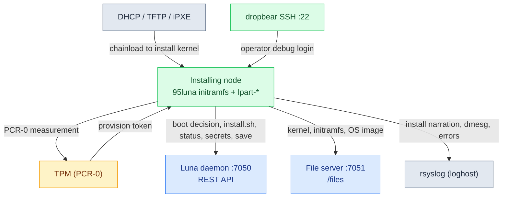

# Luna Node Installer — Integrations

*What this page is for: every external system the installing node talks to, and what happens to the install when each is unreachable. A node carries no state of its own; all of these live on the controller.*

The map below is the node at the centre and the systems it depends on, each arrow labelled with what crosses it:

## Luna daemon — the REST API (`:7050`)

- **Purpose:** the node's entire control plane during install — the boot decision (`/boot/search/mac/<mac>`), the TPM token exchange (`/tpm/<node>`), the rendered `install.sh` (`/boot/install/<node>`), the per-stage status (`/monitor/node/<node>`), node secrets, and the disk-layout write-back (the `save` flow).
- **Protocol / auth:** HTTPS; a TPM-issued JWT (`scope: provision`, ~60 min) carried after the token exchange. `luna.verifycert` controls TLS verification.
- **Implementing module(s):** node side `luna-installer.sh` + the `lpart` `lunaclient` package; daemon side `daemon/routes/boot.py`, `daemon/base/boot.py`.
- **Failure mode:** the fetch of `install.sh` retries until HTTP 200, so a daemon blip delays rather than fails the install. A token rejection (bad measurement) halts authentication — the node cannot install. Status POSTs are best-effort.

## File server — images & boot artefacts (`:7051`)

- **Purpose:** serves the kernel, the install initramfs, and the OS-image tarball.
- **Protocol / auth:** HTTP(S) under `/files`; the install token in an `x-access-tokens` header.
- **Transport:** honours the node's `provision_method` / `provision_fallback` — BitTorrent via `aria2c` by default, falling back to plain HTTP via `curl`; a node set to `provision_method=http` goes straight to HTTP.
- **Failure mode:** a download failure aborts the part phase; the ramdisk's retry policy re-runs the install. If the osimage is mid-repack the daemon **withholds** the boot, so the node waits rather than pulling a half-packed image.

## PXE / DHCP / iPXE

- **Purpose:** get the node from firmware to the install kernel — DHCP returns an address + a boot file that chainloads iPXE, pointed at the daemon's boot endpoint.
- **Protocol / auth:** DHCP / TFTP / HTTP; no auth until the TPM token is obtained.
- **Failure mode:** no DHCP/PXE → the node falls through its firmware boot order (typically to its own disk). The fix is the operator forcing a network boot (see **08**).

## TPM — node identity

- **Purpose:** the node reads its TPM **PCR-0** measurement and presents it (with `luna.ini` credentials) to mint the provision token that authenticates it to the daemon. The full trust sequence — measurement, token, the calls the token authorises — lives on **09 — Security Model**.
- **Protocol / auth:** local TPM read → POST to `/tpm/<node>`; the daemon validates the measurement against the node record.
- **Failure mode:** a measurement the daemon does not accept means no token, and the install cannot proceed — a deliberate hard stop, not a silent fallback.

## dropbear — SSH into the installer

- **Purpose:** an operator debug surface. A lightweight SSH daemon runs in the install initramfs on port 22, with the controller's `authorized_keys`, so an operator can log into a node that is installing or wedged.
- **Protocol / auth:** SSH; key auth against the controller key baked into the image.
- **Failure mode:** if dropbear is absent the body falls back to OpenSSH `sshd`. (Login requires the node's login shell to be listed in `/etc/shells`, which the `95luna` body ensures.)

## rsyslog — install narration

- **Purpose:** the install streams itself to the controller — a banner with the hardware and plan, every stage, a `dmesg` snapshot, and errors as `err` lines (tokens redacted).
- **Protocol / auth:** syslog forward to `luna.loghost`, landing in `/var/log/cluster-messages/<host>.cluster.messages`.
- **Failure mode:** best-effort; a logging outage costs visibility, not the install. The console TUI and the per-phase log files remain.

## 1:1 with the boundary table

Every system here appears in **01 — Architecture Overview**'s external-boundary table, and vice versa. No integration is documented in one place and not the other.

---
*Generated against `luna2-client@advanced-partitioner` on 10 Jun 2026. Next: 05 — Dependencies.*
