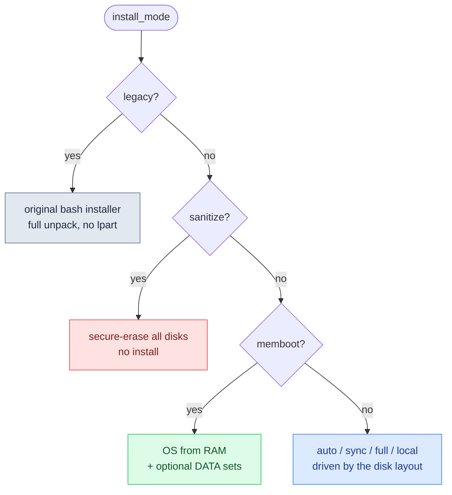
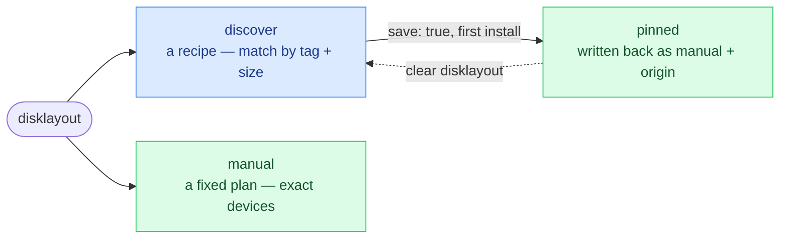
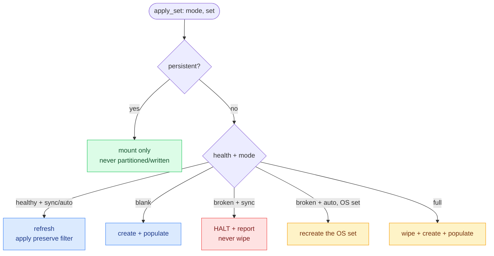

# Luna Node Installer — Configuration Reference

*What this page is for: every knob that drives an install, in one place, with its default and its danger level.* It is the authoritative home for the `install_mode` table, the `disklayout` grammar, the data fence and the kernel command line; the other pages link here rather than repeat them.

Provisioning a node comes down to **two inputs**, both ordinary Luna node/group attributes:

1. **`install_mode`** — the headline decision: what should happen to this node's OS. One value.
2. **`disklayout`** — the storage config: one or more *sets*, each with a `raid` level and a disk selection. Read only when the mode actually touches disks.

A third, **`osimage_filter`**, protects paths during a refresh. All three inherit **group→node** (the same way `prescript`/`partscript`/`postscript` do): a group default with per-node overrides is the normal way to drive a fleet. The mode follows *node wins*; the disk layout is replaced **as a whole**, never field-blended.

## `install_mode`

`auto` is the default and does the sensible thing without supervision. The other modes are for when you want to be explicit.

| `install_mode` | what happens | destroys data? |
|---|---|---|
| `auto` (default) | install if blank, refresh if healthy, repair if broken, leave data alone | only the broken or blank parts |
| `sync` | refresh the OS on an existing layout; **halt** instead of wiping if the disk is not as expected | no |
| `full` | wipe and reinstall from scratch for a guaranteed clean state | yes, on purpose |
| `local` | boot the OS already on disk, fetch nothing | no |
| `memboot` | run the OS from RAM (diskless), optionally mount local DATA | no |
| `sanitize` | securely erase the node's disks for a new tenant, no install | yes, on purpose |
| `legacy` | run the original bash installer unchanged (full unpack) | per the old script |

How the mode is dispatched:



`auto`/`sync`/`full`/`local` use the disk layout. With a data-only layout (no OS set), `auto` runs the OS from RAM as `memboot` does and mounts the DATA sets; the other disk modes refuse it with a clear message and touch no disk. `memboot` consults the layout only for optional DATA sets. `sanitize` ignores it. `legacy` ignores it entirely. Set it with `luna node change <node> --install-mode <mode>` (or `luna group change`).

## `disklayout` — the set of sets

A disk layout is a **set of sets**: at most one **OS** set (where the system installs) and any number of **DATA** sets. Each set answers two questions.

**Which disks?** — and behind every field, a disk layout is only ever **one of three things**:

| Path | You write | On every boot | Determinism |
|---|---|---|---|
| **Discover** | `selection: discover` + a `match` | re-matches disks by tag/size, fresh each time | fleet-flexible, never fixed |
| **Discover, then pin** | `selection: discover` + `save: true` | first install resolves the recipe and writes it back as `manual`; every boot after is the pinned plan | becomes fixed after first install |
| **Manual** | `selection: manual` + device paths | uses exactly those devices | fixed from the start |

This is the one idea to carry through: a layout is a **recipe** (discover) or a **fixed plan** (manual), plus a one-way migration (`save`) that freezes a resolved recipe into a plan. Revert by deleting the pin — clear the node's `disklayout` and it falls back to the group's recipe.



**`match`** (for discover) filters by media tag, size and model — a disk must satisfy all listed: `tags` (every tag present), `min_size`/`max_size`, `model` (substring). Tags are auto-derived at discovery: `rotary` (spinning), `ssd` (any solid state, incl. NVMe), `nvme` (a subset of `ssd`). E.g. `{ "tags": ["rotary"], "min_size": "8T" }` picks spinning disks of ≥8 TB.

**How to arrange them?** — the `raid` field:

| `raid` | arrangement | disks | gives you |
|---|---|---|---|
| `none` | single disk | 1 | no redundancy |
| `0` | stripe | 2 | speed, no redundancy |
| `1` | mirror | 2 | redundancy |
| `5` | single parity | 4–5 | capacity, survives one disk loss |
| `6` | dual parity | 5+ | capacity, survives two disk losses |
| `10` | stripe + mirror | 4 | redundancy + speed |

A **volume** is one mountpoint + filesystem within a set, backed by a `provider` (`partition` or `lvm`). A DATA set can be marked **`persistent: true`** — a firm promise that the installer never partitions, formats or overwrites it; it is only mounted.

The OS set declares a vfat `/boot/efi` volume on **both** firmware modes, and the layout is identical on both. Firmware is not a field: it is whichever mode the node PXE-booted in. On UEFI the installer writes GRUB, the signed shim and the NVRAM boot entry; on legacy BIOS/CSM it writes the shim and the boot entry never, and GRUB only when the OS set asks for it, so by default the node PXE-boots every time. A BIOS node is refused in one case only — an install ramdisk that is not dracut-based, which would reboot into a disk with no bootloader and loop back into PXE for ever (`luna osimage pack` an image carrying dracut).

The OS set may carry **`bootloader`**, the only boot field in the grammar:

| value | meaning |
|---|---|
| absent, `last` | the default: GRUB, the shim and the NVRAM entry are installed, with the network entry ahead of the disk in the boot order |
| `first` (also `grub`, `yes`, `true`) | the same, but the TrinityX entries go to the head of the boot order, so the node boots its own disk when the network does not answer. Firmware that re-applies its Setup priorities at POST can undo it; the install warns and the summary says so rather than claiming the disk is first. On legacy BIOS this is the only value that asks for a bootloader at all: the layout leads each boot disk with a one-mebibyte `EF02` BIOS boot partition and GRUB is written to every boot disk, with no shim and no boot order |
| `none` (also `no`, `false`) | no bootloader at all — no initramfs rebuild, no shim, no NVRAM entry — and an existing GRUB setup is removed, so the node cannot still be firmware-booted from the old install. The node PXE-boots every time; the dracut-ramdisk refusal above applies here too |

It is valid on the `os` set only, the ESP is still declared and formatted either way, and the same refusal rules apply on BIOS — where there is no boot order to arrange, so `last` installs nothing and says so in one info line. Because `first` is the only BIOS spelling for "install a bootloader", a group spanning both firmwares also moves its UEFI nodes to the head of the boot order; a per-group or per-node layout is the way around that. A BIOS GRUB install is refused with `safety_refusal=missing-bios-boot-partition` when the layout carries no BIOS boot partition, which only a rebuild creates — reinstall with `install_mode full`.

### The data fence (what each mode may wipe)

The per-set apply logic, the heart of the data-safety guarantee:



- A DATA set is wiped only by an explicit `full`, never `auto`/`sync`.
- A `persistent` set is wiped by **no** normal mode (including `full`) — only `sanitize`.
- `sync` never destroys existing data; on a broken/mismatched disk it **halts**.

Set it with `luna node change <node> -qdisklayout <file.json>` (or `luna group change`).

### Example — discovered RAID1 OS with a hardened LVM split

```json
{
  "sets": [
    { "name": "os", "role": "os", "selection": "discover", "raid": "1",
      "match": { "tags": ["ssd"] },
      "volumes": [
        { "name": "uefi", "mountpoint": "/boot/efi", "fs": "vfat", "provider": "partition", "size": "600M" },
        { "name": "boot", "mountpoint": "/boot", "fs": "xfs", "provider": "partition", "size": "1G" },
        { "name": "root", "mountpoint": "/", "fs": "xfs", "provider": "lvm", "size": "100%" }
      ] }
  ]
}
```

## `osimage_filter` — the preserve model

When a node refreshes a healthy disk under `sync` or `auto`, the installer converges the on-disk OS to the golden image — removing files the image no longer ships, refreshing the rest. `osimage_filter` protects what must not be touched. It is the **content-side** counterpart to the data fence (which protects whole sets at the disk level); the filter protects individual **paths** inside the OS set. Three lists, each becoming a `tar` exclude at extract:

| List | Meaning | Becomes |
|---|---|---|
| `preserve` | on-disk file/dir wins, never overwritten by the image | `--exclude=./PATH` |
| `preserve_empty` | keep the directory, drop its contents | `--exclude=./PATH/*` |
| `no_new_files` | never created from the image (mountpoints, pseudo-fs) | `--exclude=./PATH` |

Paths are image-relative, no leading slash; `*` globs across slashes; trailing `***` means the directory and everything under it. The filter is honoured **only when a refresh converges an existing, healthy disk** — `auto`/`sync` on a healthy disk: yes; first install / `full` / `memboot`: no (promoted to a full extract, nothing to preserve); persistent sets: always excluded regardless. Set it with `luna node change <node> -qosimage-filter <file.json>`.

## The kernel command line (daemon→node)

For an install boot the daemon sets the kernel command line — the contract the ramdisk reads. This is the authoritative listing; **03 — Data Flows** shows where in the boot chain each parameter is consumed.

```
root=luna  boot=ramdisk
luna.url=https://<controller>:7050   luna.node=<name>   luna.hostname=<fqdn>
luna.mac=<provisioning-NIC MAC>      luna.ip=dhcp|<ip>/<mask>   luna.gw=<gw>
luna.verifycert=<bool>   luna.loghost=<controller>   luna.service=0|1
```

`root=luna` makes the Luna ramdisk hook take over instead of mounting a real root. `luna.service=1` short-circuits to a maintenance shell and installs nothing.

## Related fields

| Field | Role |
|---|---|
| `osimage` | the golden image (a tarball on the controller) this node installs; inherits group→node |
| `netboot` | `true` → the daemon serves the installer on PXE; `false` → the node boots its own disk |
| `provision_method` / `provision_fallback` | image transport (`torrent` via `aria2c` → `http` via `curl` by default) |
| `prescript` / `partscript` / `postscript` | the pre/part/post field scripts — on a model node, one-line shims that exec `lpart-phase` |

---
*Generated against `luna2-client@advanced-partitioner` on 10 Jun 2026. Borrowed from the storage & provisioning design spec §2 & §5. Next: 07 — Testing & Quality.*
