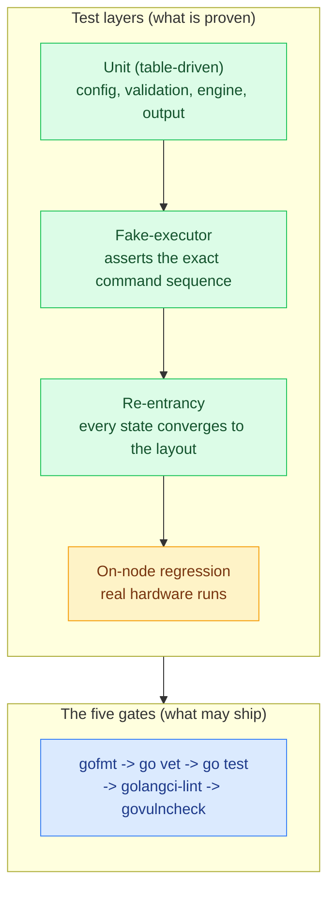

# Luna Node Installer — Testing & Quality

*What this page is for: how the installer is built, checked, and proven — how to run the tests, what they cover, and what they do not.* The implementation follows a written engineering standard (the `go/` and `gitlab-trinityx/` kits over a shared `PRINCIPLES.md`).

Trust is built in four layers and held by five gates — the layers prove correctness without touching a disk, the gates stop anything unproven from shipping:

## Framework

Go (standard-library first, strictly typed), tested with the standard `go test` toolchain. Lives in `advanced-partitioner/`. The daemon side is Python.

## How to run

From `advanced-partitioner/`:

| Goal | Command |
| --- | --- |
| Full gate (lint + type + test + vuln) | `make check` |
| Tests only | `go test ./...` |
| A single package | `go test ./internal/diskresolve/` |
| With coverage | `go test -cover ./...` |

> *Run-output figures below are taken from the design spec's reported run; re-run* `make check` against the current tree to refresh them.

## The gates (the review)

Nothing is "done" until **five checks pass identically** on a developer machine and in CI; a red gate is never overridden, and a lint suppression must carry a written, narrow reason.

| Gate | What it runs | Blocking |
| --- | --- | --- |
| `gofmt` | formatting | yes |
| `go vet` | suspicious constructs | yes |
| `go test` | the unit/golden/fake-executor/re-entrancy suite | yes |
| `golangci-lint` | govet, staticcheck, errcheck, **gosec**, revive, … | yes |
| `govulncheck` | known vulnerabilities on the shipped toolchain | yes |

## Test layers

Trust is built in layers:

- **Table-driven unit tests** — config parsing, validation, the decision engine, output.
- **Fake-executor tests** — assert the exact command sequence a plan would issue, without touching a disk (the `executor` chokepoint makes this possible).
- **Re-entrancy tests** — clean, already-done, partial, conflicting and failure states all converge to the declared layout.
- **On-node regression** — real hardware runs.

## Coverage & status (as reported)

- **67 test files, 406 test functions across 39 packages — all green.**
- **~72% mean statement coverage**, concentrated where the risk is: the disklayout grammar/validator ~74%, the disk resolver ~78%, the daemon write-back client ~87%.
- The full gate is green with **zero lint findings and zero known vulnerabilities** on the shipped toolchain.
- The decision engine's **data fence** and the `save` write-back are pinned by a table-driven matrix; the `save` flow was validated **end-to-end on a real node** (discover resolved a two-disk RAID1, the layout was pinned back to the controller, and the node rebooted onto it). That on-hardware run caught an encoding bug the in-memory tests could not see (a raw-JSON layout stored malformed; fixed by base64-encoding it) — which is why the model is proven on metal, not only in unit tests.

## What is hardware-proven vs wired-not-yet-proven

A page that hides its gaps is not trusted. Honest status:

| Target | Status |
| --- | --- |
| redhat / x86\_64 | **validated end-to-end on real hardware** |
| openSUSE / x86\_64 | client + pack proven on the old SUSE image; SUSE **bootloader adapter is a deliberate stub** |
| Ubuntu / x86\_64 | dracut install proven on hardware (RAID1) |
| ARM (all distros) | wired, **not yet on-node-proven** |
| memboot / diskless tmpfs pivot | install completes, but the final switch\_root into the RAM root is **not yet proven** (see 10) |

These feed **10 — Gaps & Risks**; none are hidden assumptions.

---
*Generated against `luna2-client@advanced-partitioner` on 10 Jun 2026. Borrowed from the storage & provisioning design spec §8. Next: 08 — Operations & Runbook.*
