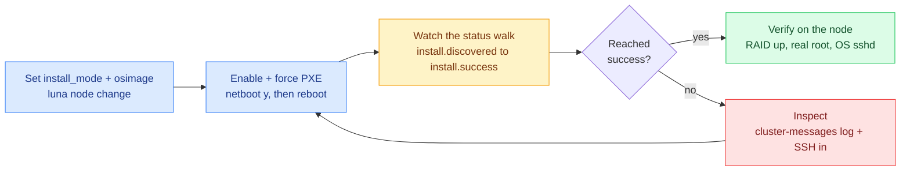

# Luna Node Installer — Operations & Runbook

*What this page is for: the 02:00 page — copy-paste commands to drive a node install, watch it, and recover it, with no theory.*

The operator loop, end to end:

## Trigger a (re)install

Set the node's mode and image with `luna node change`, ensure it will network-boot (`netboot y`), then force a one-time network boot in the node's UEFI boot manager and reboot it. With `netboot` true the daemon serves the installer; without forcing the network boot, the firmware may pick the disk first.

## Watch an install (live)

- `luna node show <node>` — the `status` field walks from `install.discovered` through to `install.success`.
- The rsyslog narration lands in the controller's cluster-messages log for that host (the `.cluster.messages` channel) — banner, every stage, and any error line.
- The daemon log shows the node's boot decision and render.
- You can SSH into the install initramfs (dropbear, port 22, controller key) to inspect a node that is installing or wedged.

## Pack / repack an image

After changing image contents or the installer binaries, rebuild the kernel and install initramfs with `luna osimage pack <image>`. It assembles the kernel and the dracut install initramfs (with the `95luna` module) and creates the provisioning. A node that boots mid-pack is withheld until the pack finishes.

## Service map

| Service | Port | Role |
| --- | --- | --- |
| `luna2-daemon` | 7050 | REST API, boot config, `install.sh`, status, secrets |
| file server | 7051 | kernel, initramfs, OS image tarball |
| DHCP / TFTP | std | network-boot chainload to iPXE |
| dropbear (installing node) | 22 | SSH-into-installer (debug) |

## Verify after an install

`luna node show <node>` reports `Luna installer: success`; on the node the RAID arrays are assembled, the real root filesystem is mounted, and the installed OS SSH service is active (rather than the initramfs).

## Common failures

| Symptom | Likely cause | Fix |
| --- | --- | --- |
| Node boots its disk instead of installing | firmware chose the disk before the network | force the network boot; confirm `netboot` is on |
| Install loops, never reaches `success` | wrong template for the image (e.g. a diskless image under the lpart pipeline) | set the matching `install_mode` (e.g. `legacy` for a legacy diskless image) |
| SSH-into-installer denied | (historical) the dropbear login shell missing from the shells list | fixed in the `95luna` body; ensure the image carries the current client |
| GRUB rescue prompt after install | abrupt reboot or bootloader mismatch | re-pack and reinstall; review the `lpart-bootloader-finalise` output in the log |

## Recovery and destructive modes

If a node wedges and out-of-band power is unavailable, SSH into the installer and reboot it from there. To force another network-install cycle on a node that keeps booting its disk, clear its TrinityX NVRAM boot entry first so the firmware falls through to the network.

> ⚠ **Mind the destructive modes.** `install_mode=full` reinstalls the OS set from scratch; `sanitize` is the tenant-handover mode that clears the node's disks. The blast radius is the whole node's storage. Neither touches a `persistent` DATA set except `sanitize`.

---
*Generated against `luna2-client@advanced-partitioner` on 10 Jun 2026. Next: 09 — Security Model.*
