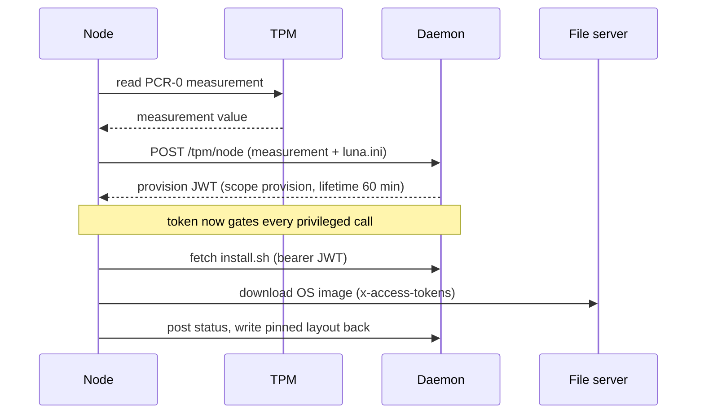

# Luna Node Installer — Security Model

*What this page is for: how trust is established during a node install, stated honestly — what authenticates a node, what the resulting token may do, and what surface is exposed while it installs.*

The trust sequence in brief — the TPM measurement mints a short-lived token, and that token is the only thing that authorises the calls that follow:

## Authentication — the node to the controller

A node proves its identity with its **TPM**. It reads the **PCR-0** measurement and presents it, with the `luna.ini` credentials, to the daemon at `/tpm/<node>`. The daemon validates the measurement against the node record and returns a short-lived **JWT** (`scope: provision`, lifetime ~60 min), stored at `/lunatmp/token.dat`. That token authorises every subsequent call — fetching `install.sh`, downloading the image, posting status, writing a pinned layout back. A measurement the daemon does not accept yields no token, and the install stops — a deliberate hard stop, not a silent fallback.

## Authorisation — scope of the token

The provision token is **single-purpose and time-boxed**: `scope: provision`, ~60 minutes. It is enough to install the node and nothing more. It is carried in an `x-access-tokens` header to the file server and as a bearer JWT to the daemon API.

## Secret handling

- **Redaction.** The install token is **masked in every log line** — the `executor` chokepoint (the single point all external commands pass through) redacts it, so the rsyslog narration to the controller never leaks the token.
- **Node secrets** are fetched into the freshly-installed OS during the `node_secrets` step (status `install.secrets`), over the authenticated daemon API — not baked into the image.
- **TLS.** `luna.verifycert` governs certificate verification of the daemon/file-server endpoints.
- The install initramfs carries the controller's SSH host keys, `authorized_keys` and `luna.ini` (delivered into the image at pack time), so the debug SSH surface trusts only the controller's key.

## Network exposure during install

- The only inbound surface on an installing node is **dropbear SSH on port 22**, key-only, accepting the controller's `authorized_keys`. It exists for operator debugging of a node that is installing or wedged. It is part of the ephemeral install initramfs and is torn down when the install completes and the node pivots into its real OS.
- All outbound calls (daemon, file server) are authenticated once the token is held; before the token, only DHCP/PXE — an unauthenticated transport by nature, which the TPM step then gates.

## Boot integrity

- **UEFI only**, with a **signed shim + GRUB** written into the ESP by `lpart-bootloader-finalise`. There is no BIOS/CSM path. This is the foundation the planned Secure-Boot and measured-boot work builds on.
- ARM servers boot UEFI by the SBBR standard — the same signed path, no special handling.

## Attack-surface notes

| Surface | Mitigation |
| --- | --- |
| dropbear SSH on the installer | key-only, controller key, ephemeral (initramfs only) |
| the provision token | short-lived, single scope, redacted in logs |
| DHCP/PXE (unauthenticated) | gated by the TPM measurement before anything privileged happens |
| `install.sh` is daemon-rendered and executed on the node | fetched only over the token-authenticated API; the daemon is the trusted renderer |

## Dependency security

Covered on **05 — Dependencies** and **07 — Testing**: `govulncheck` gates the Go build (zero known vulnerabilities on the shipped toolchain); `gosec` runs in `golangci-lint`.

## Roadmap (see 10)

**Measured boot and attestation** — extending the existing TPM authentication to measure the whole boot chain and produce a verifiable attestation — is the headline security roadmap item, to meet the multi-tenant GPU-cloud bar.

---
*Generated against `luna2-client@advanced-partitioner` on 10 Jun 2026. Next: 10 — Gaps & Risks.*
