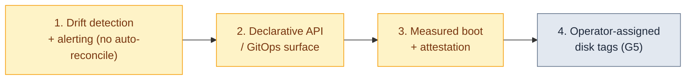

# Luna Node Installer — Gaps & Risks

*What this page is for: the critical-analysis page that keeps the rest honest.* Every item here is surfaced by another page or by reading the code; nothing is hidden.

## Register

| # | Gap / risk | Evidence | Impact | Likelihood | Suggested action | Status |
| --- | --- | --- | --- | --- | --- | --- |
| G1 | memboot / diskless **tmpfs pivot** not proven on HW | 07 status table | a `memboot` node completes install but may not switch\_root into the RAM root | M | prove the diskless pivot on hardware before recommending `memboot` | open |
| G2 | **SUSE bootloader adapter is a stub** | `internal/bootloader/suse.go`; 01/07 | a SUSE node cannot finish a disk install (refuses with a clear error, does not half-install) | M | implement the SUSE family adapter | **code-closed 2026-07-10** (adapter + unit suite; on-image run pending) |
| G3 | **ARM not on-node-proven** | 07; six packaging trees | ARM builds exist but no hardware run confirms an end-to-end install | M | wire + run one ARM target | open |
| G4 | daemon `install_mode` routing + `templ_install_lpart.cfg` **not upstream** | 01/02 note; lives in the deployed daemon | a fresh controller from `luna2-daemon:development` lacks the routing until the patch is applied | H | land the daemon MR | open |
| G5 | **operator disk tags** not delivered | roadmap item 4 | `match` selects only by auto media class (ssd/nvme/rotary), not site labels | L | design tag assignment + delivery | open |
| G6 | torrent tuning **fixed, not an operator knob** | 03 §7 (image transport) | no per-site tuning of the BitTorrent transport | L | expose if a site needs it | open |

| G7 | **UEFI boot-chain (mirrored ESP/boot for raid1/5/6/10) not HW-proven** | ADR 0012; Phase-8 matrix V10/V12 | a redundant-root node may not boot after disk-0 loss until validated | M | boot-after-disk-pull matrix on UEFI hardware | open (TOP HW item) |
| G8 | **Wrapper park (rc 2/3) not exercised end-to-end on PXE** | ADR 0011; 95luna LUNA_SAFETY_RC | a fatal refusal could conceivably loop if the wrapper regresses | L (unit+bash reviewed) | one fence-halt PXE run on an lpart-wired controller | open |

*Owners are assigned per merge request and tracked in GitLab, not on this page.*

## Roadmap

The installer meets the core of what the cloud-native / AI-factory world expects (01 "Where we stand"). Four items remain before it is a clean fit for a continuously-managed, multi-tenant AI factory, in priority order:

Each carries a *why now / why not the obvious thing*:

1. **Drift** ***detection and alerting*****, not auto-reconcile.** A running node can drift (a disk pulled, a RAID set degraded, a config hand-edited). Kubernetes-style tooling auto-corrects continuously; **we deliberately do not want that** — silently re-imaging or rebooting a node in the middle of a multi-day training run or a tightly-coupled MPI job is worse than the drift. The goal is to *know*: a lightweight on-node check exporting Prometheus metrics so a degraded array or missing disk raises an Alertmanager alert, and the **operator** decides when to drain/reinstall. Detection is the goal; remediation stays a human decision.
2. **A declarative API / GitOps surface.** The config is data already but not yet a typed API object an external controller reconciles. A typed node/group spec (ideally a custom resource) would let a fleet be changed by a commit and reconciled by Argo/Flux, the way Metal3 / Cluster API do.
3. **Measured boot and attestation.** The installer already uses a TPM token to authenticate a node; extending that to measure the boot chain and produce a verifiable attestation would meet the multi-tenant GPU-cloud security bar. Firmware/GPU-level attestation stays a platform concern to integrate with.
4. **Operator-assigned disk tags** (G5) — let `match` select by site-specific labels, not only media class.

## Decisions needed (human)

- **Continuous auto-reconcile is a deliberate non-goal** for HPC/AI (see roadmap #1). Confirm this stance holds as multi-tenant AI-factory requirements firm up.
- The priority order of the roadmap vs. landing the daemon MR (G4) and finishing the SUSE adapter (G2).

## Accepted risks

Each risk below is accepted deliberately by the installer's design owners as of this revision (10 Jun 2026):

- **UEFI only; no BIOS/CSM path.** Accepted deliberately (it is also what the Secure-Boot / measured-boot work builds on). ARM boots UEFI via SBBR, the same path.
- **`legacy` mode is supported indefinitely** as a thin per-node choice, so a cluster can migrate node-by-node; it is not a deprecation deadline.

---
*Generated against `luna2-client@advanced-partitioner` on 10 Jun 2026. Roadmap borrowed from the storage & provisioning design spec §9.*
