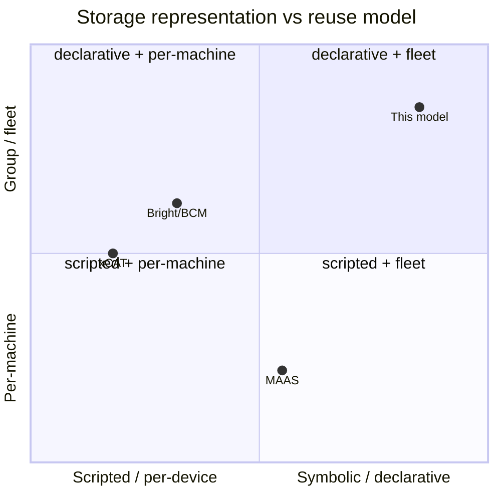

# Luna Node Installer — Comparison & Prior Art

*What this page is for: locating this installer's provisioning model against the real alternatives, fairly and from their own documentation.* The point is honesty: the model borrows good ideas where they exist and is explicit about where a peer is genuinely better.

## The peers

- **Canonical MAAS** — Metal-as-a-Service; commissions each machine into a server-side inventory, then `curtin` builds a per-machine storage graph at deploy time.
- **Bright / BCM (NVIDIA Base Command Manager)** — the established HPC/AI cluster manager; provisions from images with an `installmode` per node/category.
- **xCAT** — the long-standing HPC provisioning toolkit; the richest set of mode names (`install`, `netboot`, `statelite`) and a partition file that is often a script.

## Comparison

| Dimension | This model | MAAS | Bright / BCM | xCAT |
|---|---|---|---|---|
| Storage representation | symbolic intent, group-scoped, resolved on the node | per-machine server objects after commissioning | per-machine disk-setup XML on node or category | per-node/group attributes, partition file |
| Disk selection | tags, size and model, or manual devices | exact device id, tags only for bcache cache | ordered block-device fallback list | exact list, or a script you write |
| "N disks to a RAID level", declaratively | **yes**, the `raid` primitive | no, only in the per-machine custom graph | no, members named by id | no, scripted |
| Media / tag awareness | auto ssd, nvme, rotary, + custom | auto ssd, rotary, nvme, + custom | none, device order | none |
| Reinstall / clean state | `install_mode` | re-deploy, or blank | `installmode` AUTO/FULL/NOSYNC/SKIP/MAIN | `nodeset install` |
| Refresh but never wipe | **yes**, `sync` halts on mismatch | not available | not available; NOSYNC wipes on mismatch | not available |
| Stateless / diskless | `memboot` | not supported | diskless block in the layout | `netboot` or `statelite` |
| Group→node override | first class | global default + per-machine | category→node | group row→node row |

## Per-peer assessment

### Bright / BCM
Bright **validates the reinstall idea almost exactly**: its `installmode AUTO` runs a check then a full reinstall only if the disk is broken — the default, just like `auto` here. The gap is that Bright has **no genuinely safe refresh**: both AUTO and NOSYNC will wipe on a layout mismatch, and Bright's own manual states that NOSYNC should not be relied on to protect data — the only safe values do not sync at all. This model's `sync` closes that gap, and a `persistent` set replaces Bright's confirm-before-wipe prompt with an outright guarantee. **Worth borrowing:** the check-then-reinstall default is the right instinct, and this model adopts it.

### MAAS
MAAS is the **closest on disk layout** but takes the opposite architecture: it commissions each machine into a server-side object inventory, then has `curtin` build a per-machine graph at deploy time. Named layouts select disks by exact id; the only symbolic choice is bcache picking the smallest SSD with a flat fallback. Reuse across machines is a global default or a hand-written commissioning script — so MAAS users end up building the group-level symbolic resolver this model provides natively. **Worth borrowing (and this model does):** tags, selection by size, graceful fallback and spares — without the per-machine commissioning step.

### xCAT
xCAT carries the **richest set of mode names** (`install`, `netboot`, `statelite`) and needed a third word, `statelite`, for the middle ground this model treats as a *derived* label (stateless-vs-stateful is read off `install_mode`, never an input). Its disk selection is a partition file that is often a script rather than a declarative topology. **Worth noting:** xCAT's vocabulary is more mature; this model deliberately collapses it to one `install_mode` enum plus a derived label.

## Sources

Claims about peer behaviour are drawn from each product's own documentation: the Bright/BCM administrator manual (the `installmode` values and the NOSYNC data-safety caveat), the MAAS storage/commissioning documentation (`curtin`, named layouts, bcache selection), and the xCAT documentation (`install`/`netboot`/`statelite`, the partition file). *(Reconfirm exact wording against the current published manuals before external citation.)*

## Differentiation summary

This model represents storage as **symbolic intent resolved on the node** — "N disks of this media class to this RAID level" — where MAAS resolves a per-machine graph on the server, Bright names members by id, and xCAT scripts it. It is the only one of the four with a **safe refresh that halts rather than wipes** on mismatch (`sync` + the data fence + `persistent` sets), and it treats stateless/stateful as a derived label rather than a separate code path.

---
*Generated against `luna2-client@advanced-partitioner` on 10 Jun 2026. Borrowed from the storage & provisioning design spec §4.*
