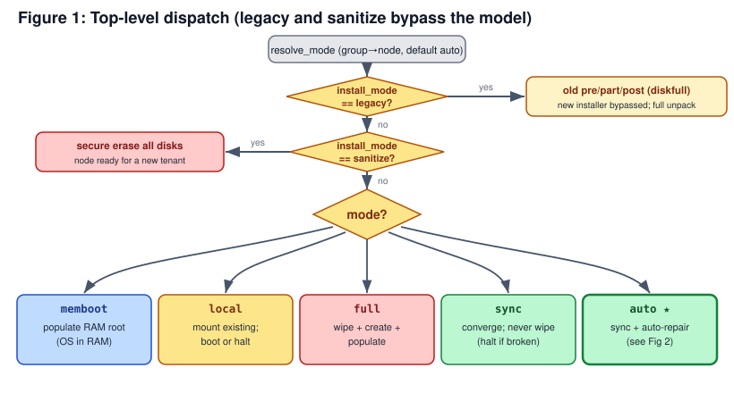
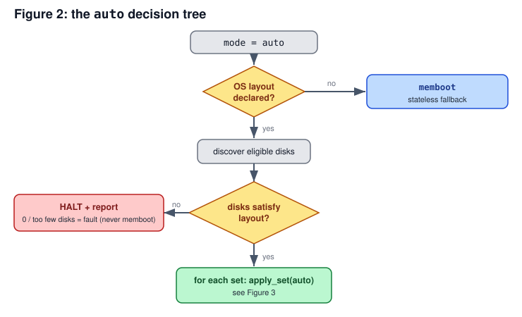
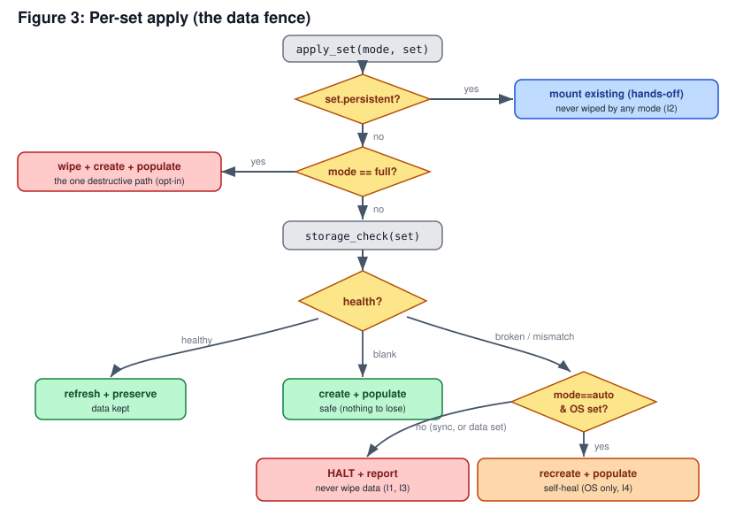

# TrinityX / Luna: A Declarative Node Provisioning Model for the HPC, AI Factory and Kubernetes Era

**Design specification, v1.4**
Component: `clustervision/luna2-client/advanced-partitioner`

## Contents

1. **Overview**: why this model exists and how it fits the modern HPC, AI factory and Kubernetes world.
2. **The model at a glance**: the two inputs, the install modes, the disk layouts, and the one choice underneath them all, discover, pin, or manual.
3. **Vocabulary**: the terms used in this document, defined once.
4. **Comparison**: how this differs from MAAS, Bright, and xCAT.
5. **Design**: the exact behaviour, decision trees, the data fence, disk selection, and configuring the OS image.
6. **Installer workflow**: how a node boots and installs, end to end, including how the image is downloaded and extracted.
7. **How it fits into TrinityX**: the node and group fields, and inheritance.
8. **Cool facts**: what changed from the old installer, what is pluggable, and how it is built and tested.
9. **Roadmap**: what we still need for continuous, multi tenant AI factory operation.

---

## 1. Overview

Cluster provisioning has changed its language. The Kubernetes generation expects infrastructure to be declarative: you state the desired end result and the system makes reality match it. It treats machines as interchangeable rather than precious, it ships operating systems as images, and it expects systems to heal themselves. Bare metal has followed the same path through projects like Metal3, Cluster API, Talos and Canonical MAAS. The build out of AI factories has raised the bar again. NVIDIA DGX SuperPOD, Base Command Manager and Mission Control provision thousands of GPU nodes from golden images, with group level configuration, fast re provisioning, tenant isolation and fleet wide telemetry.

Most HPC tooling has stayed in the older style of hand written partition scripts and per node configuration, where every node is a pet. This model brings the modern, declarative style to TrinityX and Luna node provisioning. A single `install_mode` field is a node's desired state. `auto` heals a node back to health, and `sync` converges its disk to a golden image without touching declared data. Disks are chosen by tags, which is the bare metal equivalent of a label selector, rather than by device path, so one group definition fits a fleet whose hardware varies. Stateless nodes that run from RAM and nodes with persistent local data are both first class.

Being honest about where we stand matters more than the label. We already speak the core of the modern vocabulary. The model reconciles a node to its desired state at boot. What is still missing for day to day operation is not continuous auto reconcile — re converging a running node on a timer, the way Kubernetes or Talos do, is the wrong default for HPC and AI factory work, where a node is usually in the middle of a long job — but drift *visibility*: surfacing a node that has drifted as a Prometheus signal so an operator can decide when to act. The remaining gaps are described in the Roadmap (section 9). The table below is the short version.

| What the cloud native and AI factory world expects | Where this model stands |
|---|---|
| Declarative desired state | Covered. One `install_mode` per node or group. |
| Self healing and reconcile | Covered. `auto` repairs a node back to a healthy state. |
| Converge to a golden image, repeatable | Covered. `sync` converges and is safe to repeat. |
| Choose hardware by labels, not device paths | Covered. Disks chosen by tags (ssd, nvme, rotary) and size. |
| Group level config with per node override | Covered. Group to node inheritance. |
| Stateless compute plus persistent data | Covered. `memboot` and persistent DATA sets. |
| Secure wipe for tenant turnover | Covered. The `sanitize` mode. |
| Continuous drift detection while a node runs | Planned as observability: drift surfaced via Prometheus + alerting so an operator acts. Auto reconcile on a timer is a deliberate non goal for HPC/AI. See Roadmap. |
| A declarative API and GitOps surface | Not yet. See Roadmap. |
| Measured boot and remote attestation | Not yet. See Roadmap. |

---

## 2. The model at a glance

Provisioning a node comes down to two inputs.

1. `install_mode` is the headline decision: what should happen to this node's operating system. One value, set per node or per group.
2. The storage config, called `disklayout` in Luna, describes the node's disks: one or more sets, each with a `raid` level and a disk selection. It is read only when the `install_mode` actually touches disks.

That second point is the heart of the design. The mode decides whether disks are in play at all, and the disk layout decides how. A node that boots from RAM needs no disk layout, a node kept on the legacy installer ignores it, and a node installed to disk is driven by it.

### The install modes

`auto` is the default and does the sensible thing without supervision: install if the disk is empty, refresh if it is healthy, repair if it is broken, and never touch your data. The other modes exist for when you want to be explicit.

| `install_mode` | what happens | destroys data? |
|---|---|---|
| `auto` (default) | install if blank, refresh if healthy, repair if broken, leave data alone | only the broken or blank parts |
| `sync` | refresh the OS on an existing layout, and stop instead of wiping if the disk is not as expected | no |
| `full` | wipe and reinstall from scratch for a guaranteed clean state | yes, on purpose |
| `local` | boot the OS already on disk, fetch nothing | no |
| `memboot` | run the OS from RAM (diskless), optionally mount local DATA | no |
| `sanitize` | securely erase the node's disks to hand it to a new tenant, no install | yes, on purpose |
| `legacy` | run the original bash installer unchanged (full unpack) | per the old script |

`auto`, `sync`, `full` and `local` use the disk layout. `memboot` consults it only for optional DATA disks. `sanitize` erases the disks and ignores the layout. `legacy` ignores it entirely.

### The disk layout

A disk layout is a set of sets. A node has at most one OS set, where the system installs, and any number of DATA sets for extra storage. Each set answers two questions.

The first is which disks to use. With `selection: discover` the disks are discovered and matched by tag and size, so "two SSDs" or "five spinning disks of at least eight terabytes" fits a whole group whose disks sit in different slots or differ in size. With `selection: manual` you list the exact device paths, for the cases where it must be deterministic. A set is one or the other; a group can discover while a node pins manual devices, and a discovered set can ask to be pinned to what it found on first install (the `save` flag, section 5.5).

The second is how to arrange them, set by the `raid` field.

| `raid` | arrangement | disks | gives you |
|---|---|---|---|
| `none` | single disk, no RAID | 1 | one disk, no redundancy |
| `0` | stripe | 2 | speed, no redundancy |
| `1` | mirror | 2 | redundancy |
| `5` | single parity | 4 or 5 | capacity, survives one disk loss |
| `6` | dual parity | 5 or more | capacity, survives two disk losses |
| `10` | stripe and mirror | 4 | redundancy and speed |

A DATA set can be marked persistent, which is a firm promise that TrinityX never partitions, formats or overwrites it. It is only mounted. That is what makes "run the OS from RAM but keep my local data" a normal, safe configuration rather than a scripting workaround.

### Discover, pin, or manual: the essence of the disk layout

This is the one idea to carry through the rest of the document. Set the modes aside for a moment, because behind all the fields a disk layout is only ever one of two things, with a one way road between them:

- a **discover** layout is a *recipe* — "two SSDs", "four rotary disks of at least 8 TB" — that the installer resolves into real devices freshly on every boot;
- a **manual** layout is a *fixed plan* — the exact device paths, identical on every boot.

So the real decision an administrator makes, the true meaning of the JSON, is a choice between those two and whether to migrate from the first to the second. That is three paths:

| Path | You write | On every boot | Determinism |
|---|---|---|---|
| **1. Discover** | `selection: discover` | re-matches disks by tag and size, fresh each time | fleet-flexible, never fixed |
| **2. Discover, then pin** | `selection: discover` + `save: true` | first install resolves the recipe and writes it back to the node as `manual`; every boot after is the pinned plan | becomes fixed after the first install |
| **3. Manual** | `selection: manual` + device paths | uses exactly those devices | fixed from the start |

1. **Discover, every boot.** The installer matches disks by tag and size each time it provisions, so one group definition fits a whole fleet whose disks sit in different slots or differ in size. Nothing is pinned; the layout stays a recipe. This is the right default when machines are interchangeable.

2. **Discover once, then pin.** Add `save: true` to a discover set. The first install resolves the recipe, lays the disks down, and then writes the concrete result back to that node as a `selection: manual` layout. From then on the node reproduces those exact disks, deterministically. This is the migration from path 1 to path 3, performed by the machine rather than by hand — fleet wide discovery on day one, per node determinism forever after.

3. **Manual from the start.** You hand write the device paths yourself. Repeatable and deterministic by construction, for hardware that is known and must not vary.

The JSON, then, is a choice between a recipe and a fixed plan, plus a one way migration (`save`) that freezes a resolved recipe into a plan. The road runs one way on purpose: you can pin a discovered layout, and you revert simply by deleting the pin — clear the node's `disklayout` and it falls back to the group's recipe and discovers again. Everything else in this document, the modes, the data fence, RAID and persistence, operates on whichever of these three you have chosen. The full mechanics of pinning are in section 5.5.

---

## 3. Vocabulary

- **Node provisioning**: bringing a node from power on to a running OS.
- **Golden image**: the authoritative OS contents, a tarball, held on the Luna server.
- **Converge**: make the node's on disk OS equal to the golden image, except for protected paths.
- **Set**: a named group of disks holding a coherent group of volumes. A node has at most one `os` set and any number of `data` sets.
- **`role`**: a set's purpose, `os` or `data`. This is separate from TrinityX's Ansible `roles` (controller, compute, login), which are a different layer and are untouched here.
- **Volume**: one mountpoint and filesystem within a set, backed by a provider (`partition` or `lvm`).
- **`raid`**: a set's RAID arrangement, one of `none`, `0`, `1`, `5`, `6`, `10`, with a member count and optional hot spares. `none` is a single disk. **The OS set is restricted to 1, 2 or 4 drives with `none`/`1`/`0`/`10`** (operator decision 2026-07-16): parity RAID (`5`/`6`) is refused at config validation for `role: os`, because GRUB cannot reliably boot a degraded parity array (NB-10 — only raid1 is degraded-bootable) — parity there trades real bootability for imagined redundancy. `data` sets keep the full palette including `5`/`6`.
- **`disklayout`**: the node's whole disk layout, the set of sets. This is the attribute you set in Luna. A set's `raid` is one property inside it, not the same thing.
- **`selection`**: how a set's disks are chosen, `discover` (matched by tags and size) or `manual` (exact devices). It is the disk-choosing axis, distinct from `install_mode`; the older name `auto` is retired to avoid the clash with `install_mode: auto`.
- **`save`**: a per set flag, valid only on a `selection: discover` set. When set, the installer writes the layout it resolved back to the node so the next boot reproduces it. Defined in section 5.5.
- **`origin`**: provenance the installer stamps on a layout it pinned (where it came from, when, by which tool, on which host). Not operator input; it round-trips when a pinned layout is read back. Section 5.5.
- **`match`**: the filter for `selection: discover`, by tags, size and model rather than by path. Explained with examples in section 5.3.
- **disk tags**: media classes derived automatically at discovery (`rotary`, `ssd`, `nvme`) plus any operator set tags.
- **Preserve list**: the paths a refresh must not clobber. This is the data safety mechanism on the content side.
- **`persistent`**: a per set flag that marks the set hands off. It is never partitioned, formatted or written to, only mounted. It survives `auto`, `sync` and `full`; only `sanitize` erases it.
- **Sync**: the word has two meanings. Bright and xCAT use it for rsync delta versus full copy, a transport detail. In this model `sync` means "converge the disk to the golden image, remove leftover files, and protect the preserve list". It is independent of transport, so the result on disk is the same whether the bytes move by tar or by rsync.
- **Stateless and stateful**: a derived label, not a setting. People assume stateless means diskless (RAM root) and stateful means installed to disk, but the real property is whether state survives a reboot, which follows from the wipe and preserve policy rather than the media. The common middle ground, a disk installed OS that is refreshed while data persists, has no agreed name. xCAT coined `statelite` for it, and Bright's overlapping `installmode` values blur it further. This model never takes stateless or stateful as an input. It is read off the `install_mode`.

---

## 4. Comparison: MAAS, Bright, xCAT

| Dimension | This model | MAAS | Bright / BCM | xCAT |
|---|---|---|---|---|
| Storage representation | symbolic intent, group scoped, resolved on the node | per machine server objects after commissioning | per machine disk setup XML on node or category | per node and group attributes, partition file |
| Disk selection | tags, size and model, or manual devices | exact device id, tags only for bcache cache | ordered block device fallback list | exact list, or a script you write |
| "N disks to a RAID level", declaratively | yes, the `raid` primitive | no, only in the per machine custom graph | no, members named by id | no, scripted |
| Media or tag awareness | auto ssd, nvme, rotary, plus custom | auto ssd, rotary, nvme, plus custom | none, device order | none |
| Reinstall and clean state | `install_mode` | re deploy, or blank | installmode AUTO, FULL, NOSYNC, SKIP, MAIN | nodeset install |
| Refresh but never wipe | yes, `sync` halts on mismatch | not available | not available, NOSYNC wipes on mismatch | not available |
| Stateless or diskless | `memboot` | not supported | diskless block in the layout | netboot or statelite |
| Group to node override | first class | global default plus per machine | category to node | group row to node row |

A few points the table cannot hold.

Bright and BCM validate the reinstall idea almost exactly. Its `installmode AUTO`, which runs a check and then a full reinstall only if the disk is broken, is the default, just like `auto` here. The gap is that Bright has no genuinely safe refresh. Both AUTO and NOSYNC will wipe on a layout mismatch, and its own manual states that NOSYNC should not be relied on to protect data. The only safe values do not sync at all. This model's `sync` closes that gap, and a persistent set replaces Bright's confirm before wipe prompt with an outright guarantee.

MAAS is the closest on disk layout but takes the opposite architecture. It commissions each machine into a server side object inventory, then has curtin build a per machine graph at deploy time. Its named layouts select disks by exact id, and the only symbolic choice is bcache picking the smallest SSD and falling back to flat. Reuse across machines is done with a global default or a hand written commissioning script, which means MAAS users end up building the group level symbolic resolver that this model provides natively. The ideas worth borrowing from MAAS are tags, selection by size, graceful fallback and spares, without the per machine commissioning.

xCAT carries the richest set of mode names (install, netboot, statelite) and needed a third word, statelite, for the middle ground that this model treats as a derived label. Its disk selection is a partition file that is often a script rather than a declarative topology.

---

## 5. Design

### 5.1 Mode behaviour

The mode is resolved with group to node inheritance and then dispatched. `legacy` short circuits the whole model. `memboot` runs the OS from RAM and only consults the disk layout for DATA sets. `sanitize` securely erases the disks. The rest drive the disks.



```
provision(node):
  mode := resolve_mode(node)            # group to node, default auto (legacy if unmigrated)
  if mode == legacy:   run_legacy_pre_part_post(); done   # full unpack, no preserve filter
  if mode == sanitize: secure_erase(all local disks); done
  switch mode:
    memboot -> populate_ram_root(); apply DATA sets (if any); done
    local   -> mount_existing(); boot_or_halt()
    full    -> wipe + create + populate non-persistent sets; mount persistent sets
    sync    -> apply(sync_policy)
    auto    -> apply(auto_policy)
```

`sync` and `auto` differ in exactly one case, a broken or mismatched disk. `sync` halts and reports, `auto` recreates the broken part and continues. A declared OS layout asserts that the node has disks, so if `auto` cannot satisfy it (no disks, too few, or no match) that is a fault to surface, not a reason to silently run from RAM. `memboot` is reached only when no OS layout is declared at all.



```
auto:
  os_layout_declared?  (raid or devices[])
    NO  -> memboot                              # nothing diskful declared, stateless fallback
    YES -> resolve OS set (discover: match disks; manual: devices[])
           disks satisfy it (count, match, size tolerance)?
             NO  -> HALT + report               # 0, too few, or no match, a fault, never memboot
             YES -> for each set: apply_set(auto, set)
```

The firmware mode is detected, never configured: it is whichever mode the node PXE-booted in. On UEFI, the modes that install a bootloader (`auto`, `sync`, `full`, `local`) write GRUB, stage the signed shim and register the NVRAM boot entry, choosing the x86_64 or aarch64 EFI binary from the node's architecture. ARM server platforms boot UEFI by the SBBR standard, so they follow the same path with no special handling.

The one knob is the OS set's `bootloader` key: `last` — the default when the key is absent — leaves the network entry ahead of the disk, so the controller keeps deciding how the node boots; `first` puts the TrinityX entries at the head of the boot order, for a cluster whose nodes must come up without the controller (firmware that re-applies its own Setup priorities at POST can override it, and the install says so instead of claiming success); `none` installs nothing at all — no initramfs rebuild, no shim, no NVRAM entry — and removes an existing GRUB setup, so a node switched to `none` cannot still be firmware-booted from the old install. `first` is accepted as `grub`, `yes` or `true`, and `none` as `no` or `false`. `first` is also the only value that asks for a bootloader on legacy BIOS, so a group spanning both firmwares moves its UEFI nodes to the head of the boot order as the price of booting its BIOS ones; a per-group or per-node layout is the way to split them.

A legacy BIOS or CSM node partitions, extracts and mounts as a UEFI node does, down to the vfat ESP at `/boot/efi` — so a node moved to UEFI later needs no repartition. The shim and the boot order are always skipped, because BIOS has no equivalent of either, and so is GRUB unless the OS set asks for it with `bootloader: first`: the storage result then records `boot_method: none`, the install logs one warning, and the node PXE-boots on every boot, which is how the model works on UEFI as well. With `first` the layout leads each boot disk with a one-mebibyte BIOS boot partition (type `EF02`, no filesystem and no mountpoint, so it is never a volume) for GRUB's core image, and the install writes GRUB to every boot disk so a mirrored set boots from either — no shim, no NVRAM entry, no boot order. Only a layout rebuild creates that partition, so finalising a BIOS GRUB install without one is refused with `safety_refusal=missing-bios-boot-partition`, naming `install_mode full` as the fix. One case is refused before any disk is touched: a disk OS whose install ramdisk is not dracut-based reboots into the disk instead of pivoting to it, and with no bootloader there it would loop back into PXE for ever. Secure Boot and measured boot, in section 9, build on the UEFI path.

<div style="break-before: page;"></div>

### 5.2 The data fence



```
apply_set(mode, set):
  if set.persistent: mount_existing(set); return        # hands off, any normal mode
  health := storage_check(set)
  (sync|auto, healthy) -> refresh_preserve(set)
  (sync|auto, blank)   -> create + populate(set)
  (sync,      broken)  -> HALT + report                  # never wipe
  (auto,      broken)  -> recreate+populate if role==os; else HALT
  (full,      *)       -> wipe + create + populate(set)
```

The guarantees that fall out of this:

- A DATA set is wiped only by an explicit `full`, never by `auto` or `sync`.
- A persistent set is wiped by no normal mode, including `full`. It is only mounted. The one exception is `sanitize`, which is the deliberate tenant handover erase and is meant to clear everything.
- `sync` never destroys existing data. On a broken or mismatched disk it halts.
- `auto` may recreate the OS set, which carries no user data. DATA sets halt rather than be wiped.
- No mode wipes a disk on a mismatch except the OS set under `auto` or `full`. This closes the case where a renumbered disk triggers an accidental wipe.

There is one more behaviour worth stating plainly. Because `memboot` consults the disk layout for DATA sets, "run the OS from RAM but keep my local data" is expressed directly: a `memboot` node with one persistent DATA set. The data is partitioned and formatted by no one, only mounted under `/sysroot`, and it stays mounted across the switch to the RAM root. `memboot` runs no bootloader finalise, so the mount is not written into `/etc/fstab`; `auto` with a data-only layout takes the same RAM-root path and does write it. The set's volumes are the single source of truth for the mounts. The image lay down also excludes persistent mountpoints, so nothing can write into them. Wiping such data on every boot is not a default and is not expressible without a deliberate, separate choice.

### 5.3 Disk selection with tags and size

When a set uses `selection: discover` you do not name devices. You describe the disks you want with a `match` filter and the installer picks matching disks at boot. This is the same idea MAAS uses, where you ask for a disk by tag and a minimum size, written as `storage=label:size(tags)`. Our `match` works the same way and adds a maximum size as well.

Each disk is tagged automatically at discovery, from the kernel:

- `rotary`: a spinning hard disk.
- `ssd`: any solid state disk. This includes NVMe.
- `nvme`: the NVMe disks, which are a subset of `ssd`.

So an NVMe drive carries both `ssd` and `nvme`, a SATA or SAS SSD carries `ssd`, and a hard disk carries `rotary`. Operators can also attach their own tags to specific disks; how those are assigned and delivered is a roadmap item (section 9).

A `match` can combine three things, and a disk must satisfy all of them:

- `tags`: the disk must carry every tag listed.
- `min_size` and `max_size`: the disk must be at least, or at most, that size. Either can be left out.
- `model`: the disk model name must contain this text.

Examples:

- `{ "tags": ["ssd"] }` picks any solid state disk, NVMe included.
- `{ "tags": ["nvme"] }` picks NVMe disks only.
- `{ "tags": ["rotary"], "min_size": "8T" }` picks spinning disks of at least 8 TB.
- `{ "tags": ["ssd"], "min_size": "400G", "max_size": "2T" }` picks SSDs between 400 GB and 2 TB.

An omitted `match` means any eligible disk. From the disks that match, the layout takes its member count, plus any spares, smallest first, with a same size tolerance (5 percent by default) so the RAID members line up. A set can declare a fallback, a simpler `raid` or `memboot`, for when nothing matches; a declared OS layout that cannot be met halts instead.

### 5.4 Group to node

Both inputs live at the group level and are overridable per node. A group set to `install_mode: auto` with a discovery disk layout serves an entire mixed group from one definition, and a node overrides with manual devices or a different mode where it matters. The mode follows node wins. The disk layout is replaced as a whole, never field blended.

One consequence of inheritance shapes the next section. The instant a `disklayout` is set at the node level it shadows the group's: a later edit to the group layout no longer reaches that node. That is exactly what you want when you deliberately pin a node, and exactly what you do not want by accident, which is why pinning is opt in.

### 5.5 Pinning a discovered layout

`selection: discover` chooses disks fresh on every boot. That is the right default for a fleet, but sometimes you want a node to keep the exact disks it found, so the layout is deterministic from then on, for example after a discovered RAID1 install you want that mirror reproduced byte for byte on the next boot rather than re resolved.

The `save` flag does this. On a `selection: discover` set, `save: true` tells the installer that, once it has resolved and applied the concrete layout, it should write that layout back to the **node's** `disklayout` as a `selection: manual` document. The next boot then reads a fixed manual layout and reproduces it. `save` is only meaningful on a discover set; on a manual set it is rejected, because a manual layout is already the pinned form.

What gets written back is the same concrete layout the installer would otherwise only print for you to copy: each resolved set becomes `selection: manual` with the devices the resolver chose, the discover only fields (`save`, `count`, `spares`, `match`) dropped, and the structural fields (role, raid, persistent, volumes) preserved. The installer also stamps an `origin` block on each set it discovered, recording that this layout was machine resolved, when, by which tool version, and on which host, so an operator can tell a pinned layout from a hand written one.

The `selection` flips from `discover` to `manual`, the `match`/`save`/`count` discover fields are gone, the two disks the resolver actually picked are now named outright, an `origin` block records the provenance, and the structural fields (`raid`, `volumes`) are carried through verbatim — so the pinned set is byte-for-byte the layout that was installed:

```json
{
  "name": "os", "role": "os", "selection": "manual", "raid": "1",
  "devices": [
    "/dev/disk/by-path/pci-0000:18:00.0-scsi-0:0:0:0",
    "/dev/disk/by-path/pci-0000:18:00.0-scsi-0:0:1:0"
  ],
  "origin": { "from": "discover", "at": "2026-06-07T12:00:00Z",
              "by": "lpart-storage-prepare 2.0-39", "host": "node001" },
  "volumes": [
    { "name": "uefi", "mountpoint": "/boot/efi",
      "fs": "vfat", "provider": "partition", "size": "600M" },
    { "name": "boot", "mountpoint": "/boot",
      "fs": "xfs", "provider": "partition", "size": "1G" },
    { "name": "root", "mountpoint": "/",
      "fs": "xfs", "provider": "lvm", "size": "100%" }
  ]
}
```

Three properties make this safe and predictable:

- **It is controller state, not on the disk.** The pin is stored on the Luna server, so it survives every reimage mode, including `full` and `sanitize` which wipe the disk itself. The pin records intent; the wipe and rebuild then reproduce it.
- **It cannot loop.** The write back turns the node's set into `manual`, and `manual` never writes back. A pinned node stays pinned without re writing itself on every boot.
- **It is non fatal.** Pinning is a convenience layered on a working install. If the write back cannot reach the server the install still succeeds, the layout is already on disk, and the same layout is printed in the part log as a ready to paste block to apply by hand.

**Reverting to discovery** is deleting the pin. Clear the node's `disklayout` (`luna node change <node> --disklayout ''`) and the node falls back to the group's `discover` layout on the next boot, choosing disks fresh again.

One scope note. Because `save` can sit on a **group's** discover set, every node in that group writes its own node level pin on first install. That is deliberate and is often what you want for a group of machines with differing disks, but it does mean each node forks off the group template from then on, by the inheritance rule in section 5.4. Choosing group level `save` is choosing per node pins for the whole group.

### 5.6 Worked examples

Each example is one node configuration: the `install_mode`, a Luna attribute, and, where the mode touches disks, the storage config.

**1. Stateless. The OS runs from RAM, no disks are touched.**

```text
install_mode = memboot
```

**2. Single disk, auto discovery.**  `install_mode = auto`

```json
{
  "sets": [
    {
      "name": "os",
      "role": "os",
      "selection": "discover",
      "raid": "none",
      "volumes": [
        { "name": "uefi", "mountpoint": "/boot/efi",
          "fs": "vfat", "provider": "partition", "size": "600M" },
        { "name": "boot", "mountpoint": "/boot",
          "fs": "xfs", "provider": "partition", "size": "1G" },
        { "name": "root", "mountpoint": "/",
          "fs": "xfs", "provider": "lvm", "size": "100%" }
      ]
    }
  ]
}
```

**3. Manual RAID1 with a separate-mount LVM layout. The OS mirrored across two named disks, split into the separate mounts a hardened RHEL build uses.**  `install_mode = auto`

The ESP and `/boot` are plain partitions on the mirror; everything else is an LVM logical volume in one volume group on the RAID1 device, so the split is easy to resize later. The sizes are typical Red Hat separate-mount values (`/var`, `/var/log`, the separate `/var/log/audit` that STIG hardening wants, `/tmp`, and swap); `/` takes the remainder with `size: 100%`.

```json
{
  "sets": [
    {
      "name": "os",
      "role": "os",
      "selection": "manual",
      "raid": "1",
      "devices": [
        "/dev/disk/by-path/...a",
        "/dev/disk/by-path/...b"
      ],
      "volumes": [
        { "name": "uefi", "mountpoint": "/boot/efi",
          "fs": "vfat", "provider": "partition", "size": "600M" },
        { "name": "boot", "mountpoint": "/boot",
          "fs": "xfs", "provider": "partition", "size": "1G" },
        { "name": "swap", "mountpoint": "swap",
          "fs": "swap", "provider": "lvm", "size": "8G" },
        { "name": "var", "mountpoint": "/var",
          "fs": "xfs", "provider": "lvm", "size": "8G" },
        { "name": "varlog", "mountpoint": "/var/log",
          "fs": "xfs", "provider": "lvm", "size": "4G" },
        { "name": "audit", "mountpoint": "/var/log/audit",
          "fs": "xfs", "provider": "lvm", "size": "2G" },
        { "name": "tmp", "mountpoint": "/tmp",
          "fs": "xfs", "provider": "lvm", "size": "4G" },
        { "name": "root", "mountpoint": "/",
          "fs": "xfs", "provider": "lvm", "size": "100%" }
      ]
    }
  ]
}
```

**4. Stateless OS with persistent local DATA, kept and mounted, never touched.**  `install_mode = memboot`

```json
{
  "sets": [
    {
      "name": "data",
      "role": "data",
      "selection": "manual",
      "raid": "none",
      "devices": [ "/dev/disk/by-path/..." ],
      "persistent": true,
      "volumes": [
        { "name": "data", "mountpoint": "/data", "fs": "xfs", "provider": "partition" }
      ]
    }
  ]
}
```

**5. Mirrored OS plus striped scratch. Two disks RAID1 for the OS, two disks RAID0 for data, both discovered.**  `install_mode = auto`

```json
{
  "sets": [
    {
      "name": "os",
      "role": "os",
      "selection": "discover",
      "raid": "1",
      "match": { "tags": ["ssd"] },
      "volumes": [
        { "name": "uefi", "mountpoint": "/boot/efi",
          "fs": "vfat", "provider": "partition", "size": "600M" },
        { "name": "boot", "mountpoint": "/boot",
          "fs": "xfs", "provider": "partition", "size": "1G" },
        { "name": "root", "mountpoint": "/",
          "fs": "xfs", "provider": "lvm", "size": "100%" }
      ]
    },
    {
      "name": "scratch",
      "role": "data",
      "selection": "discover",
      "raid": "0",
      "match": { "tags": ["nvme"] },
      "volumes": [
        { "name": "scratch", "mountpoint": "/scratch",
          "fs": "xfs", "provider": "lvm", "size": "100%" }
      ]
    }
  ]
}
```

**6. Discover then pin. A mirrored OS chosen by tag on first install, then frozen to the disks it found.**  `install_mode = auto`

```json
{
  "sets": [
    {
      "name": "os",
      "role": "os",
      "selection": "discover",
      "raid": "1",
      "match": { "tags": ["ssd"] },
      "save": true,
      "volumes": [
        { "name": "uefi", "mountpoint": "/boot/efi",
          "fs": "vfat", "provider": "partition", "size": "600M" },
        { "name": "boot", "mountpoint": "/boot",
          "fs": "xfs", "provider": "partition", "size": "1G" },
        { "name": "root", "mountpoint": "/",
          "fs": "xfs", "provider": "lvm", "size": "100%" }
      ]
    }
  ]
}
```

After the first install the node's own `disklayout` becomes a `selection: manual` mirror over the two SSDs it picked, stamped with `origin` (section 5.5). To let it discover fresh again, clear the node's `disklayout`.

### 5.7 Configuring the OS image

Section 5 so far has covered which disks a node uses and what happens to them. This section covers the other half: which OS image lands on those disks, and what survives a refresh.

**Selecting the image.** A node gets its OS from the `osimage` field, the name of a golden image (a tarball, section 3) held on the Luna server. Like every field here it inherits group to node (section 5.4), so a group sets the image once and a node overrides it only where it has to. Set it with `luna node change <node> --osimage <name>`, or at the group level with `luna group change`.

**The preserve model: `osimage_filter`.** When a node refreshes a healthy disk under `sync` or `auto`, the installer converges the on disk OS to the golden image: it removes files the image no longer ships and refreshes the rest. The `osimage_filter` field is how you protect what must not be touched. It is the content side counterpart to the data fence (section 5.2): the data fence protects whole data sets at the disk level, while the filter protects individual paths inside the OS set.

The filter is a small JSON document with three lists. A sensible default — the paths that should normally survive a refresh on a compute node, and the one already applied to `compute-group` on this controller — is:

```json
{
  "preserve": [
    ".autofsck",
    "boot/grub2/grub.cfg",
    "lib/modules/*/kernel/drivers/video/nvidia*.ko",
    "usr/lib/modules/*/kernel/drivers/video/nvidia*.ko",
    "var/log/***",
    "var/spool/mail/***",
    "var/lib/logrotate.status",
    "var/lib/systemd/random-seed",
    "var/lib/sss/***",
    "var/spool/anacron/***"
  ],
  "preserve_empty": [
    "tmp",
    "var/tmp",
    "var/spool/postfix",
    "home",
    "scratch",
    "data",
    "local"
  ],
  "no_new_files": [
    "boot/efi",
    "proc",
    "sys",
    "lost+found",
    ".autorelabel"
  ]
}
```

- `preserve`: the on disk copy wins and is never overwritten by the image — the things the node owns or edits in place. In the default above that is the node-built NVIDIA kernel module, its grub config, its logs, local mail, and the small pieces of system state that must never be reset (`logrotate.status`, the systemd `random-seed`, the SSSD cache, anacron timestamps).
- `preserve_empty`: keep the directory but never repopulate it from the image — scratch and spool areas (`tmp`, `var/tmp`, `var/spool/postfix`) and the local data roots (`home`, `scratch`, `data`, `local`). On most clusters those data roots are their own DATA sets on their own disks, where the data fence (section 5.2) already protects them; these entries simply cover the case where they are plain directories inside the OS filesystem.
- `no_new_files`: never create this path from the image at all — mount points and pseudo-filesystems: the ESP (`boot/efi`, owned by `lpart-bootloader-finalise`), `proc`, `sys`, `lost+found`, and the `.autorelabel` trigger.

Paths are image relative, with no leading slash. A plain path matches exactly (`etc/hosts`). A `*` is a glob that spans slashes, so `var/*` reaches into subdirectories. A trailing `***` means the directory and everything under it (`var/log/***`). Set the filter the same way you set the disk layout: `luna node change <node> -qosimage-filter <file.json>`, or `luna group change` for a whole group.

**How `install_mode` decides whether the filter applies.** A preserve list only has meaning when there is a prior OS on the disk to preserve. So the filter is honoured only when a refresh converges an existing, healthy disk:

| `install_mode` | Filter honoured? | Why |
|---|---|---|
| `auto` (healthy disk) | yes | refresh converges, the preserve list protects your edits |
| `sync` (healthy disk) | yes | refresh converges, the preserve list protects your edits |
| `auto` or `sync` (blank disk, first install) | no | promoted to a full extract, there is no prior state to preserve |
| `full` | no | a deliberate clean wipe |
| `memboot` | no | the RAM root is always fresh |
| `local` | n/a | no image is installed |
| any mode, persistent sets | always excluded | a separate safety, never touched in any mode (section 5.2) |

Internally each list entry becomes a `tar` exclude during the extract:

| List | Meaning | Becomes |
|---|---|---|
| `preserve` | on disk file or directory wins | `--exclude=./PATH` |
| `preserve_empty` | keep the directory, drop its contents | `--exclude=./PATH/*` |
| `no_new_files` | never created from the image | `--exclude=./PATH` |

So a node that should converge to the golden image while keeping one edited config and its logs is simply `install_mode: sync` with the `osimage_filter` above, configured in the same group to node style as the disk layouts in section 5.6. These behaviours are pinned by the regression suite (section 8): `sync` keeping a preserve file while deleting cruft, `full` ignoring the filter, and a blank disk promoting to a full extract.

---

## 6. Installer workflow

This model adds storage logic to a boot chain that is otherwise the **existing Luna installer**. To see exactly where it fits — and to answer the common questions (when is the installer chosen, where do the pre/part/post scripts run, when is the BMC set up, what starts sshd) — this section walks the real sequence end to end: power-on → ramdisk → the dynamically-rendered `install.sh` → the node's `prescript` / `partscript` / `postscript` → the `lpart-*` binaries. A node carries no state of its own; everything is fetched from the controller (the Luna daemon API on `:7050`, the image file server on `:7051`).

Figure 4 is the whole sequence on one page: the boot chain, the install ramdisk that brackets the run, and every `install.sh` step as a colour-coded block — grey for framework plumbing, amber for the node's own `prescript` / `partscript` / `postscript` (the Luna group/node script attributes), green for the `lpart-*` workers those scripts drive. The subsections that follow walk it in order. *(This figure describes the standard RHEL line — dracut `95luna` / `luna2-start.sh`.)*


### 6.1 From power-on to `install.sh` — the boot chain

1. **Firmware → DHCP → iPXE.** The NIC firmware does DHCP; the cluster DHCP server returns an address plus a `next-server` and a boot file that chainloads **iPXE**, which is pointed at the daemon's HTTP boot endpoint.
2. **The boot menu (`GET /boot`).** iPXE DHCPs each NIC and, after a short default, runs `chain /boot/search/mac/<mac>`: the node hands its MAC back to the daemon and asks *"who am I, and what should I boot?"*
3. **Install, or boot the disk? (`discover_mac`).** The daemon identifies the node by MAC, resolves its osimage's kernel/initramfs, and checks the node/group **`netboot`** flag:
   - **`netboot = false`** → it serves the **local-disk boot** script; the node `sanboot`s its own disk and **`install.sh` never runs**. This is the steady state of an installed node — after a successful install it boots its disk, not the installer. (The localboot model registers exactly this UEFI entry in the post phase.)
   - **`netboot = true`** → it serves the **install boot** script; the node is marked `install.discovered`. (If the osimage is mid-repack the daemon withholds the boot, so the node waits rather than pulling a half-packed image.)
4. **Load the install kernel + initramfs.** iPXE fetches the osimage's **kernel** and the **install initramfs** from `:7051/files`, sets the kernel command line, and boots. That command line is the daemon→node contract — every parameter the ramdisk needs:
   ```
   root=luna  boot=ramdisk
   luna.url=https://<controller>:7050   luna.node=<name>   luna.hostname=<fqdn>
   luna.mac=<provisioning-NIC MAC>      luna.ip=dhcp|<ip>/<mask>   luna.gw=<gw>
   luna.verifycert=<bool>   luna.loghost=<controller>   luna.service=0|1
   ```
   `root=luna` is what makes the Luna ramdisk hook take over instead of mounting a real root.

### 6.2 Inside the install ramdisk — *before* `install.sh`

The install initramfs is the **same packed image's** ramdisk with the Luna dracut module `95luna` (`luna2-start.sh`) baked in. It carries the toolset (disk tools, `curl`/`aria2c`, `tpm2`, the `dropbear` SSH daemon), the controller's SSH host keys + `authorized_keys`, `luna.ini`, and the `lpart-*` binaries. In order, before any install logic:

1. **Network + a debug surface.** The hook sets the hostname, **starts `dropbear` (an SSH daemon on port 22) and a login shell on `tty2`** so an operator can SSH into a node that is installing or wedged, then brings the provisioning NIC up — matching `luna.mac` to an interface and configuring it by DHCP or the static `luna.ip`/`luna.gw`. (`luna.service=1` short-circuits here to a plain shell and installs nothing.)
2. **Authenticate (TPM token).** The node reads its TPM **PCR-0** measurement and POSTs it with the `luna.ini` credentials to **`/tpm/<node>`**; the daemon validates the measurement against the node record and returns a short-lived JWT (`scope: provision`, ~60 min), saved to `/lunatmp/token.dat`. This token gates everything that follows.
3. **Fetch the installer.** The hook curls **`/boot/install/<node>`** (carrying the token) and retries until HTTP 200 — the body is `install.sh`, rendered fresh by the daemon (next section).
4. **Run it, with a retry policy.** `install.sh` runs; on success the ramdisk tears down (kills `dropbear`/dhclient, moves the install log into `/sysroot/var/log`) and pivots into the freshly-provisioned root. On failure the hook is deliberate — it snapshots `dmesg`, forwards the log to the controller, and either **parks** in a maintenance shell (unrecoverable config error, exit code 3) or shows an **interruptible 30-second countdown** before retrying.

### 6.3 The dynamic installer — `install.sh`, and where pre/part/post run

`install.sh` is **not a fixed file**: the daemon renders it per request and **chooses the template from the node's `install_mode`** —

- `install_mode = legacy` → the **original bash installer** (full image unpack via `tar`, the node's bash pre/part/post scripts, no `lpart-*`).
- any other mode (`auto`/`sync`/`full`/`local`/`memboot`/`sanitize`; default `auto`) → the **v1.4 lpart installer**.

Same packed image, same install ramdisk for both — *only the rendered `install.sh` differs*, picked from one field. Moving a node between `legacy` and the model is a field change; nothing is rebuilt. (This `install_mode` routing currently lives in the **deployed** daemon and is staged for upstream, not yet merged — section 8.)

The daemon fills the template with the node's rendered config: the file URLs and token, the OS image name, the **provision method/fallback**, the per-interface network, the BMC config, the **base64-encoded pre/part/post field scripts**, and — for the lpart template — the node's `install_mode`, `disklayout`, and `osimage_filter` (written into the runtime dir as JSON).

**When pre/part/post run — at a glance.** Each is the node's field script, fired by `install.sh` at a fixed point in the sequence. On a node running this model the script is a one-line shim that execs `lpart-phase`, so the table's right column is *what the lpart pipeline actually does* in that phase:

| Phase | Fires at (in `install.sh`) | What `lpart-phase <phase>` runs |
|-------|---------------------------|---------------------------------|
| **pre**  | **step 4** — before the runtime inputs are written, before BMC | `prepare-runtime` — make the runtime/sysroot dirs. (That is the only load-bearing work; the image-unpack *bypass* is **not** done here, it is structural in the template — `download_image`/`unpack_imagefile` are hard no-ops, rows 8–9.) |
| **part** | **step 7** — after BMC setup, before the (no-op) legacy download and the network/secrets work | `install-context` → `storage-prepare` (discover/partition/RAID/LVM/mkfs/mount) → `osimage` (download + extract into the sysroot). **This is where the disk is written and the OS lands.** |
| **post** | **step 13** — after the OS is on disk *and* the network + secrets are in place | `bootloader` finalise (fstab, signed shim + GRUB into the ESP, UEFI NVRAM entry) — which is *why* it is post: the installed system must already exist |

That is the whole answer to "when do pre/part/post run": **pre** prepares the runtime, **part** does storage + image, **post** makes it bootable. All three are *invoked* by the unchanged legacy `install.sh` framework (its `prescript`/`partscript`/`postscript` functions b64-decode the node's field script and run it); on a model node that field script is a shim that execs `lpart-phase`. The image-unpack bypass is the template's own doing (the no-op `download_image`/`unpack_imagefile`), not the pre phase's. The sections below are the full sequence those three plug points sit inside.

**The full sequence.** `install.sh` runs top to bottom; there is **no reboot inside it** — it ends by reporting success and control returns to the ramdisk, which pivots into `/sysroot`. Each `install.<stage>` is a `POST /monitor/node/<node>` — the *"Luna installer: <stage>"* lines the controller shows and streams. The three `▶` rows are the plug points from the table above:

| # | Step | What it does | Status |
|---|------|--------------|--------|
| 1 | `lunainit` | create the runtime + systemroot dirs | |
| 2 | `dynamic_ip_check` | if DHCP, POST the leased IP back to the node record | |
| 3 | `node_scripts` | download any `--scripts` plugin scripts | `install.scripts` |
| 4 | **`prescript`** ▶ | run the node's **pre** field script | `install.prescript` |
| 5 | `write_provisioning_inputs` | write `storage.json` / `osimage-filter.json` / `install-context.json` for lpart | |
| 6 | `bmcsetup` *(if enabled)* | **configure the BMC** — IPMI user + network | `install.setupbmc` |
| 7 | **`partscript`** ▶ | run the node's **part** field script | `install.partscript` |
| 8–9 | `download_image`, `unpack_imagefile` | **no-ops** under lpart (owned by `lpart-osimage-install`) | |
| 10–11 | `collect_mac_n_name_net`, `change_net` | gather interfaces; set hostname + render/apply the `ifcfg` network config into the new OS | `install.setnet` |
| 12 | `node_secrets` | fetch node secrets into the new OS | `install.secrets` |
| 13 | **`postscript`** ▶ | run the node's **post** field script | `install.postscript` |
| 14 | `node_roles` *(if any)* | install + enable role units in the new OS | `install.roles` |
| 15–16 | `fix_capabilities`, `restore_selinux_context`, `update_system_info` | setcap + SELinux relabel; report vendor/asset tag | |
| 17 | `cleanup` + success | clear scratch, post final state | `install.success` |

**The plug points are unchanged Luna attributes.** Rows 4/7/13 are the node's **pre/part/post field scripts** — the *same* group→node attributes Luna has always had, inherited group→node like any other. On a node running this model each is a one-line shim:
```bash
#!/bin/bash
exec /usr/bin/lpart-phase part      # (resp. pre / post)
```
A non-zero exit from any field script aborts the install, and the ramdisk retries. On a `legacy` node the very same fields hold ordinary bash scripts and the template runs them directly — moving a node onto the model is just swapping those three scripts for the shims.

### 6.4 The `lpart-*` applications

`lpart-phase <pre|part|post>` is a thin shim that execs the orchestrator; the real work is a set of focused Go binaries — one concern each, each independently testable and dry-runnable, each ending by **proving and showing** what it did:

| Binary | Phase | What it does |
|--------|-------|--------------|
| **`lpart-node-installer`** | all | The **orchestrator**. `--phase pre\|part\|post` runs the whole pipeline in-process and drives the live TUI dashboard (or plain output with `--no-tui`). It invokes everything below. |
| **`lpart-phase`** | all | The **shim** the pre/part/post fields exec → `exec lpart-node-installer --phase <phase>`. Keeps the node's script fields one line. |
| **`lpart-storage-prepare`** | part | The **storage decision + execution**: discover disks (tags/size), resolve the layout, then partition / build RAID / create LVM / mkfs and **mount the tree at the sysroot** — dispatching on `install_mode` and enforcing the data fence. `sanitize` securely erases here and stops; `memboot` makes a tmpfs root. Ends by showing `blkid`/`pvs`/`vgs`/`lvs`/`mdadm` evidence. |
| **`lpart-storage-check`** | part | The **health probe** for an *existing* layout, used by `auto`/`sync`: OS set present and healthy → reuse-and-mount, broken → recreate. It is the whole job for `local` (verify only, no image). |
| **`lpart-osimage-install`** | part | **Download + extract** the OS image into the sysroot — honouring the node's `provision_method`/`fallback`, the `osimage_filter`, the first-install→full promotion, and the persistent-set excludes — then **verify** the extract (`/etc/os-release` present). Section 6.5. |
| **`lpart-bootloader-finalise`** | post | **Make it bootable**: write `fstab`, install the signed shim + GRUB into the ESP, register the UEFI **NVRAM** entry — then **verify** by re-reading `efibootmgr`, the ESP loaders and `grub.cfg`, and showing that evidence. On legacy BIOS it installs GRUB alone, and only for an OS set asking `bootloader: first`. Skipped for `memboot` (RAM root, no bootloader), on legacy BIOS otherwise, and for an OS set with `bootloader: none` — which also removes an existing GRUB setup. |

While the pipeline runs, `lpart-node-installer` shows the live TUI below; every step is also written to per-phase log files and forwarded by syslog to the controller at `/var/log/cluster-messages/<host>.messages`.


### 6.5 Getting the image onto the node

The OS image is laid down during the part phase by `lpart-osimage-install`, after storage is prepared and the sysroot is mounted.

**Download.** The image is fetched from the Luna file server (`http://<controller>:7051/files`, the controller derived from the node's `luna.url`). The installer **honours the node's `provision_method` and `provision_fallback`** — the same fields the legacy installer consumes — so by default it tries a BitTorrent download with `aria2c` then falls back to a plain HTTP `curl`, but a node set to `provision_method=http` downloads straight over HTTP. Both carry the node's install token in an `x-access-tokens` header and respect `luna.verifycert`. The torrent tuning is fixed today, not an operator knob (section 9).

**Extract.** The image is unpacked into the sysroot with `tar`. ACLs are enabled on a real disk filesystem and disabled on a `tmpfs` RAM root, which has no ACL support; the installer chooses this automatically from the sysroot filesystem type. There is nothing to configure.

**First install promotes to a full extract.** The installer reads the storage result from `lpart-storage-prepare`. If storage just created a blank layout, a `sync` or `auto` extract is promoted to a full extract and the `osimage_filter` is skipped, because there is no prior state to preserve. This is the runtime half of the gating rule in section 5.7.

**Persistent sets are always protected.** The mountpoints of any `persistent` data set are excluded from the extract in every mode, and the installer refuses to proceed if one is missing from the excludes. This is the data fence of section 5.2, enforced at extract time.

---

## 7. How it fits into TrinityX

A node carries two storage inputs: its `install_mode` and its storage config, the `disklayout` attribute, which is the set of sets, each with its own `raid` level. Both are ordinary node and group attributes. They inherit from group to node the same way the prescript, partscript and postscript already do, so a group default with per node overrides is the normal way to configure a fleet.

A group set to `install_mode: auto` with a discovery disk layout drives a whole mixed group from one definition, and any node can pin manual devices or choose a different mode where that matters. `legacy` is a first class mode, so a cluster can move onto this model node by node, and a node that has not been moved across yet behaves as `legacy`.

`legacy` is deliberately a thin choice, not a separate build. Every mode boots the **same** packed OS image and the same install initramfs; the only thing that differs is which `install.sh` the daemon hands the node, and it picks that from the node's `install_mode`. For `legacy` it serves the original template that runs the node's bash pre, part and post scripts and a full image unpack, with none of the `lpart-*` pipeline or the section 5 model involved. So moving a node between `legacy` and the model is just a field change: nothing is rebuilt, and the image is never repacked when a node switches modes. Repacking is only needed when the image contents or the installer binaries themselves change.

---

## 8. Cool facts: what changed, how it's built, and how it's tested

The previous Luna node installer was a set of hand written Bash pre, part and post
scripts that unpacked a full image onto every node, every time. The new installer is
a small set of Go binaries driven by the declarative model in this document. The
practical differences are worth calling out, because they are what make the model
above usable day to day rather than just on paper.

| | Old installer (Bash) | New installer (this model) |
|---|---|---|
| **Disk layout** | Mostly ad hoc shell that configured a node after a generic image unpack; storage was never a real declarative concern, and the path was not battle tested. (kickstart was referenced in places but never actually used to partition.) | One distro agnostic JSON document, the `disklayout`, the same on every OS. The Go installer turns it into partitions, RAID, LVM and filesystems directly, natively, with no kickstart/AutoYaST/Preseed layer. |
| **Choosing disks** | Device paths hard coded, or bespoke shell logic per node. | Discovery: ask for disks by tag and size (`two ssd`, `four rotary at least 8T`) and the installer matches them at boot, so one group definition fits a fleet with mixed hardware. |
| **Refresh vs reinstall** | Full unpack on every provision; no safe "update in place". (xCAT and Bright have the same gap: their safe modes either do not converge, or wipe on a layout mismatch.) | `sync` converges the on disk OS to the golden image and protects a preserve list; `auto` self heals; `full` is the explicit clean wipe. A data fence means a data set is never wiped except by an explicit `full`. |
| **Stateless plus local data** | Diskless meant losing all state on reboot; keeping local data was a scripting workaround (xCAT needed a separate "statelite" mode for the middle ground). | `memboot` runs the OS from RAM and a `persistent` data set is mounted, never touched. Stateless versus stateful is a derived label, not a separate code path. |
| **Boot scheme** | Ad hoc, and BIOS era assumptions lingered. | UEFI only, with a proper scheme every time: a vfat ESP at `/boot/efi`, a `/boot` filesystem, and the root on LVM, mirrored or striped per the set's `raid`. ARM and x86 take the same path. |
| **Visibility** | A scrolling wall of console text; if it failed you watched the console and guessed. | A live TUI dashboard (node facts, the chosen disks, per stage progress), or plain output with `--no-tui`. |
| **Did it work?** | Often a blind install: the controller learned little until the node came back, or did not. | The whole install narrates itself live to the controller over rsyslog (`cluster-messages`): a banner with the hardware and the plan, every stage, a dmesg snapshot, and any error as an `err` line. Tokens are redacted. A failure is visible the moment it happens, not after a post mortem. |
| **Pin a discovered layout** | Not a concept. | `selection: discover` with `save: true` writes the resolved layout back to the node as `manual`, so a fleet wide template can be frozen per node once it has resolved (section 5.5). |

Three facts worth calling out:

- The installer carries **no kickstart, AutoYaST or Preseed** at all. The old
  scripts referenced kickstart but never actually used it to partition; here storage
  is built natively from the JSON.
- The partitioner is **fully re-entrant**, which is a headline robustness property
  rather than a footnote (see below).
- A node can be **reinstalled repeatedly without ever wiping its data disks**,
  because wiping a data set requires saying `full` out loud.

**Re-entrancy is a key design principle, not an afterthought.** The partitioner can
be re-run any number of times within a single boot, and across any number of
reinstalls, and it always converges to the declared layout. Every step checks "is
this already done?" before acting: an already correct disk is left alone, a partial
or interrupted previous attempt is completed, and a genuinely conflicting state is a
loud error rather than a silent reformat. The practical payoff is a guarantee
operators can rely on: a retry after a transient failure, or a customer reformatting
an entire cluster, lands in exactly the same correct state every time. It is built to
be run again, by design.

### What is pluggable (and what is wired but not yet proven)

The installer is built to span distributions and CPU architectures, with the
distribution-specific parts behind a small interface rather than scattered through
the code.

- **Bootloader family is an interface.** `lpart-bootloader-finalise` selects a family
  adapter at runtime: the **RHEL** adapter (dracut, `grub2-install`,
  `grub2-mkconfig`) and the **Debian/Ubuntu** adapter (`update-initramfs`,
  `grub-install`, `update-grub`) are implemented; the **SUSE** adapter is a
  deliberate stub that refuses with a clear error rather than half-installing a
  bootloader, exactly as the Bash predecessor did. Adding a family is implementing
  one interface, not editing the storage engine.
- **Distribution quirks are isolated.** The storage code probes for what a distro
  actually ships (for example `mkfs.fat` versus `mkfs.vfat`) instead of assuming,
  so the same binary works across RHEL 8/9/10, Rocky, Alma, Debian and Ubuntu.
- **One codebase, two architectures.** Every binary is a static, cgo-free build
  cross-compiled for **linux/amd64 and linux/arm64**. Boot is UEFI only, and ARM
  servers boot UEFI by the SBBR standard, so x86 and ARM take the identical path
  with no special casing.
- **Packaging spans the matrix.** Six packaging trees exist
  (`redhat`, `opensuse`, `ubuntu` x `x86`, `arm`), each with its own RPM/DEB recipe
  that bakes the `lpart-*` binaries into the install initramfs.

Honest status: **redhat/x86_64 is the path validated end to end on real hardware.**
The openSUSE/Ubuntu and ARM trees are wired but not yet on-node-proven, and the SUSE
bootloader adapter is intentionally unfinished. Those are the next targets, not
hidden assumptions.

### How it is built and checked

The implementation follows a written engineering standard (the `go/` and
`gitlab-trinityx/` kits, over a shared `PRINCIPLES.md`). The rules that matter to a
reader judging whether to trust it:

- **Go, standard library first, strictly typed.** Dependencies are justified in a
  decision record or not added. Boring and explicit over clever.
- **One chokepoint for side effects.** Every external command runs through a single
  `executor` package, which gives uniform logging, timeouts, secret redaction (the
  install token is masked in every log line), and a real **dry-run** mode.
- **Re-entrant by design.** Every operation checks "is this already done?" before
  acting; "already in the desired state" is a no-op, "conflicting" is a loud error,
  nothing is silently force-destroyed.
- **Library code raises, only `main` decides exit codes.** Errors are wrapped with
  context as they cross package boundaries.
- **The gates are the review.** Nothing is "done" until five checks pass identically
  on a developer machine and in CI: `gofmt`, `go vet`, `go test`, `golangci-lint`
  (govet, staticcheck, errcheck, gosec, revive and more), and `govulncheck`. A red
  gate is never overridden; a lint suppression must carry a written, narrow reason.
- **Decisions are logged.** Architectural choices are append-only ADRs (for example
  the `save` write-back is ADR-0008), so the *why* survives and settled questions are
  not silently re-litigated.

### Testing, and how it went

Trust is earned by tests, in layers: table-driven unit tests for config parsing,
validation, the decision engine and output; fake-executor tests that assert the exact
command sequence a plan would issue without touching a disk; re-entrancy tests
(clean, already-done, partial, conflicting and failure states); and on-node
regression runs on real hardware.

As of this writing:

- **67 test files, 406 test functions, across 39 packages, all green.**
- **~72% mean statement coverage** across the tested packages, concentrated where the
  risk is: the disklayout grammar/validator ~74%, the disk resolver ~78%, the daemon
  write-back client ~87%.
- The full gate (`gofmt`/`go vet`/`go test`/`golangci-lint`/`govulncheck`) is **green
  with zero lint findings and zero known vulnerabilities** on the shipped toolchain.
- The decision engine's data fence and the `save` write-back are pinned by a
  table-driven matrix, and the `save` flow was validated **end to end on a real node**:
  discover resolved a two-disk RAID1, the layout was pinned back to the controller,
  and the node rebooted onto it. That on-hardware run also earned its keep by catching
  an encoding bug the in-memory tests could not see (the daemon stored a raw-JSON
  layout malformed; the fix base64-encodes it), which is precisely why the model is
  proven on metal and not only in unit tests.

---

## 9. Roadmap

The model meets the core of what the cloud native and AI factory world expects today (section 1). The secure wipe for tenant turnover that earlier sat on this list is now part of the model itself, the `sanitize` mode (sections 2 and 5). Four items remain before the model is a clean fit for a continuously managed, multi tenant AI factory, listed in priority order.

**Drift detection and alerting, not auto reconcile.** Today a node reconciles to its desired state at boot. A running node can drift afterwards: a disk is pulled, a RAID set degrades, someone edits a config by hand. Kubernetes controllers and GPU cloud day two tooling watch for that drift continuously and *auto correct* it. We deliberately do not want that here. Silently re converging or re imaging a running node on a timer is dangerous in HPC and AI factory work: a node is usually in the middle of a multi day training run or a tightly coupled MPI job, and a surprise reformat, RAID rebuild or reboot is a far worse outcome than the drift itself. What we want instead is to *know*: a lightweight on node check that periodically compares actual state against the declared layout and exports the result as Prometheus metrics, so a degraded RAID set, a missing disk or an unexpected filesystem raises an alert through the cluster's existing Prometheus and Alertmanager stack. The operator then decides when and how to act — drain the node, schedule a reinstall, replace a disk — rather than the system acting on its own. Detection is the goal; remediation stays a deliberate, scheduled, human decision.

**A declarative API and GitOps surface.** The configuration is data already, but it is not yet exposed as a typed API object that an external controller reconciles. Defining a typed schema for the node and group spec, and exposing it as a resource (ideally a custom resource so it reconciles inside Kubernetes the way Metal3 and Cluster API do), would let a whole fleet be changed by a commit and reconciled by Argo or Flux.

**Measured boot and attestation.** The installer already uses a TPM token to authenticate a node. Extending that to measure the boot chain and produce an attestation that an external service can verify would meet the security bar that multi tenant GPU clouds set. Firmware and GPU level attestation stay a platform concern to integrate with, for example through BlueField, rather than something this installer owns.

**Operator assigned disk tags.** The media tags (`rotary`, `ssd`, `nvme`) are derived automatically. Letting an operator attach custom tags to specific disks, set in Luna and delivered to the node at discovery, would let `match` select by site specific labels and not only by media class. Where those tags are set and how they reach the node is not designed yet.
